# AEP-ESOFT6SA — Interviewer

[](https://github.com/joaopaulotr/AEP-ESOFT6SA/actions/workflows/backend-ci.yml)
[](https://github.com/joaopaulotr/AEP-ESOFT6SA/actions/workflows/frontend-ci.yml)

Prova de Conceito (PoC) de um **entrevistador generalista conduzido por IA e operado por voz**.
A ferramenta conduz uma entrevista em profundidade sobre qualquer tema, decide a cada resposta se
aprofunda ou avança, e entrega ao final uma síntese estruturada do que foi dito.

---

## Documentação técnica

| Documento | Conteúdo |
|---|---|
| [`docs/arquitetura.md`](docs/arquitetura.md) | Componentes, camadas do backend, diagrama de sequência de um turno em streaming, grafo LangGraph, estrutura do frontend e decisões de projeto |
| [`docs/banco.md`](docs/banco.md) | As 4 coleções do MongoDB (campos, exemplo real de cada uma, relacionamentos), índices, pipelines de agregação, regras de exclusão, `versao` otimista e migração da v0.1.0 |
| [`docs/api.md`](docs/api.md) | Todas as rotas `/api/v1` (método, corpo, resposta, erros e eventos SSE); a versão interativa está no Swagger em `/docs` |
| [`docs/testes.md`](docs/testes.md) | Suítes (unitária, integração com Mongo real e E2E), como rodar cada uma, CI, cobertura e processo de entrega |
| [`docs/EVOLUCOES.md`](docs/EVOLUCOES.md) | Spec de evoluções (EV-xx), riscos (RK-xx) e roadmap |

## 1. Problema

Ouvir pessoas em profundidade é caro. Uma entrevista qualitativa exige entrevistador treinado,
tempo de agenda dos dois lados, transcrição e análise — e cada entrevista adicional custa quase o
mesmo que a primeira. O resultado é que quem desenha políticas públicas, serviços, programas
sociais e pesquisas ouve **poucas pessoas**.

E não são pessoas quaisquer: são as mais fáceis de alcançar. Quem tem tempo livre, quem mora perto
dos centros urbanos, quem responde formulário online, quem escreve com desenvoltura, quem já está
na lista de contatos da organização. Quem está mais distante desse perfil — e que costuma ser
justamente quem mais depende do serviço em discussão — raramente é ouvido. Decisões que afetam
essas pessoas são tomadas a partir do relato de outras.


## 2. ODS atendida — ODS 10: Redução das Desigualdades

A PoC se alinha à **ODS 10** por duas metas específicas:

| Meta | Texto (resumido) | Como a PoC atua |
|---|---|---|
| **10.2** | Promover a inclusão social, econômica e **política** de todos, independentemente de condição econômica, deficiência ou origem | Derruba as duas barreiras que decidem quem é ouvido: o **custo por entrevista**, que cai a quase zero e permite escutar muitas pessoas em vez das mais convenientes, e a **forma de responder**, que passa a ser falar, não escrever |
| **10.3** | Garantir igualdade de oportunidades, inclusive eliminando práticas discriminatórias | Aplica o mesmo protocolo de perguntas a todos os entrevistados, sem a variação de tratamento — no tempo dedicado, no tom, no quanto se insiste — que um entrevistador humano imprime conforme a classe, o sotaque ou a aparência de quem está na frente |

### Como isso aparece na solução

- **Entrevista por voz de ponta a ponta** — a resposta é falada e transcrita
  (`POST /api/v1/voice/transcricao`), e o entrevistador responde em áudio (`POST /api/v1/voice/fala`).
  A acessibilidade não é um recurso adicional: é a forma padrão de usar o sistema. Não é preciso
  ler enunciados longos, digitar nem navegar por uma interface densa.
- **Custo marginal próximo de zero** — a entrevista roda sem entrevistador humano, o que muda a
  pergunta de "quem dá para ouvir?" para "quem precisa ser ouvido?".
- **Roteiro igual para todos** — as perguntas centrais ficam num roteiro gravado no banco
  (`interview_scripts`; o padrão "Entrevista generalista" vem de `backend/app/db/seed.py`). Elas
  são as mesmas para qualquer entrevistado do roteiro, o que torna as respostas comparáveis entre si.
- **Aprofundamento adaptativo** — a cada turno o serviço decide se aprofunda ou avança
  (`InterviewService.run_turn`). Quem responde de forma curta recebe uma nova chance de
  desenvolver, em vez de ter a fala registrada como "sem conteúdo" — o que protege exatamente
  quem não tem repertório de responder pesquisa.
- **Síntese descritiva** — o relatório final organiza o que a pessoa disse, incluindo citações
  diretas, e é instruído a **não inventar informação que não esteja na transcrição**.

### Limites e riscos assumidos

Tecnologia de IA aplicada à escuta também pode **produzir** desigualdade, e a PoC reconhece isso:

- a transcrição automática tem desempenho pior com sotaques regionais e fala fora da norma culta,
  o que degrada o registro justamente de quem se quer ouvir;
- um modelo de linguagem pode carregar viés de classe ao resumir e priorizar o que foi dito;
- o uso depende de microfone e conexão, o que exclui parte do público-alvo;
- a escuta automatizada não substitui a presença de quem conhece o território — ela amplia o
  alcance, não a profundidade do vínculo.

Por isso a síntese descreve o que foi dito e **não emite nota nem juízo sobre a pessoa
entrevistada**.

## 3. Arquitetura

Três processos e um provedor externo: uma SPA React que captura e reproduz áudio no navegador, uma
API FastAPI que concentra toda a regra de negócio (e é o único ponto que fala com a OpenAI, ou com o
provider `fake`, offline) e um MongoDB com quatro coleções. Toda a API de negócio fica sob
`/api/v1`; só `/health` fica na raiz.

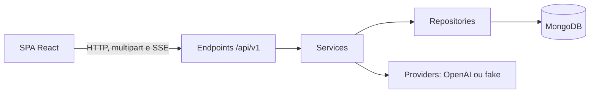

Camadas do backend (`backend/app/`): **endpoints** (`api/v1/endpoints/`) traduzem HTTP em chamadas
de **serviços** (`services/`), que usam **repositórios** (`repositories/`, os únicos que conhecem o
Mongo) e **providers** de IA (`providers/`); `core/` tem configuração, medidor de uso, log JSON e
erros. Cada classe recebe seus colaboradores pelo construtor (montados em `api/deps.py`), o que
permite trocar OpenAI e Mongo por dublês nos testes.

Em cada turno, um grafo LangGraph (`services/interview_graph.py`) faz uma checagem de segurança
determinística e **uma única chamada ao LLM**, que decide entre aprofundar, avançar ou encerrar.
O diagrama de sequência de um turno em streaming, o grafo completo e a estrutura do frontend estão
em [`docs/arquitetura.md`](docs/arquitetura.md); as rotas, em [`docs/api.md`](docs/api.md).

### Fluxo de uma entrevista

1. O frontend lista os roteiros (`GET /scripts`) e a pessoa escolhe um.
2. `POST /session` com o `script_id` abre a sessão e grava a primeira pergunta do roteiro.
3. A cada turno: a fala é transcrita, enviada em `POST /turn/{id}/stream` (SSE) e o LLM decide
   aprofundar, avançar ou encerrar; a API devolve a fala por frase e o front a reproduz em áudio.
4. Ao encerrar (`finish`), a tela de devolutiva pede a síntese; ela é gravada em `syntheses` e,
   nas próximas consultas, vem do banco sem nova chamada ao LLM.
5. **Falha do LLM no meio do turno:** a decisão é validada e tentada de novo uma vez; se continuar
   inválida ou o provedor falhar, o turno **avança para a próxima pergunta do roteiro** em vez de
   derrubar a entrevista.

### Realismo do entrevistador

A fase 3 (`docs/EVOLUCOES.md`, seção 5; referências na seção 13) deixa a conversa menos robótica:

- **Escuta ativa:** a fala começa reconhecendo o que a pessoa disse, usa tipos de sondagem
  (elaboração, exemplo, sentimento, clarificação, confirmação), não repete aberturas e retoma
  pontos de falas anteriores.
- **Persona:** nome e tom (acolhedor, neutro, formal) do roteiro entram no prompt e escolhem as
  instruções de entonação do TTS.
- **Ritmo e streaming:** o servidor emite a fala por frase (SSE, após uma única chamada ao LLM; não
  é streaming token a token). No modo texto aparece "digitando…" e o texto é revelado em ritmo
  humano; no modo voz, fillers curtos ("hmm, entendi…") cobrem a espera, em no máximo cerca de
  metade dos turnos.
- **Turn-taking:** detecção de fim de fala (VAD) com calibração de ruído, incentivo gentil após
  silêncio longo e barge-in, que só atua com cancelamento de eco no microfone. Despedida e
  acolhimento não podem ser interrompidos.
- **Interface:** onda de áudio por estado, legenda ao vivo, confirmação da transcrição (3 s, com
  opção de corrigir) e progresso "Pergunta N de M".

### Decisões de projeto (resumo)

- **A API não guarda estado em memória:** o progresso vive no documento da sessão, recarregado a
  cada turno.
- **Providers atrás de abstrações** (`LLMProvider`, `SpeechProvider`); com `LLM_PROVIDER=fake` tudo
  responde de forma determinística, sem rede e sem chave.
- **Cuidado (safety):** sofrimento (por regras ou pelo LLM) gera um acolhimento que cita o CVV
  (188, cvv.org.br) e **encerra a sessão**; só o tipo do alerta é guardado, nunca o texto da
  pessoa. A parada determinística é conservadora: só pedidos claros e curtos encerram, e **pergunta
  nunca encerra**. Na tela do participante, o acolhimento fica visível num cartão fixo do CVV
  (ligue 188, grátis, 24 h, ou cvv.org.br) com o botão "Continuar": a tela não sai sozinha.
- **A saída do LLM é validada** (Pydantic), com uma nova tentativa e fallback para `advance`; os
  logs registram só o tipo do erro, nunca o conteúdo da fala.
- **Concorrência otimista** (`versao`): uma cópia velha da sessão nunca reabre uma entrevista
  encerrada (`409`).
- **Regras de exclusão preservam o histórico:** apagar sessão apaga a síntese dela; roteiro com
  sessões só é desativado; o roteiro padrão e participantes com entrevistas não são apagados.
- **O áudio nunca é armazenado:** só o texto persiste.

Justificativas e detalhes em [`docs/arquitetura.md`](docs/arquitetura.md).

## 4. Tecnologias

| Camada | Stack |
|---|---|
| Backend | Python 3.11+, FastAPI, Pydantic, LangGraph; `python-docx` e `pypdf` (leitura de questionários), `segno` (QR code), `tzdata` (fuso de São Paulo no painel, também no Windows) |
| IA | OpenAI — `whisper-1` (transcrição), `gpt-4o-mini-tts` (voz), modelo de texto (`LLM_MODEL`, padrão `gpt-4o-mini`) para condução e síntese; provider `fake` offline |
| Banco de dados | MongoDB 7 (NoSQL), acesso assíncrono via Motor |
| Frontend | React 18, Vite, React Router, `fetch` (cliente único em `services/api.js`), tokens de design em CSS com modo claro e escuro |
| Testes | pytest, pytest-cov, mongomock-motor (backend); Playwright (E2E); ESLint (lint do frontend) |
| Infra | Docker e Docker Compose |
| CI | GitHub Actions (`.github/workflows/backend-ci.yml` e `frontend-ci.yml`) |

## 5. Como executar

### Variáveis de ambiente (`backend/.env`)

| Variável | Padrão | Função |
|---|---|---|
| `MONGO_URI` | `mongodb://localhost:27017` | Conexão com o MongoDB (no Compose é sobrescrita para `mongodb://mongo:27017`) |
| `MONGO_DB` | `app_db` | Nome do banco |
| `OPENAI_API_KEY` | vazio | Chave da OpenAI (obrigatória com `LLM_PROVIDER=openai`) |
| `LLM_PROVIDER` | `openai` | `openai` (API real) ou `fake` (offline, respostas simuladas) |
| `LLM_MODEL` | `gpt-4o-mini` | Modelo de chat usado com `LLM_PROVIDER=openai` |
| `LLM_TIMEOUT_SECONDS` | `20` | Tempo máximo de cada chamada ao provedor de IA |
| `MAX_AUDIO_BYTES` | `26214400` (25 MB) | Tamanho máximo do áudio enviado para transcrição |
| `MAX_UPLOAD_BYTES` | `2097152` (2 MB) | Tamanho máximo do questionário enviado em `/scripts/upload` |
| `FRONTEND_URL` | `http://localhost:5173` | Endereço público do frontend, usado para montar o link e o QR do convite |

No frontend, `VITE_API_URL` (padrão `http://localhost:8000`) aponta para a API.

### Com Docker Compose (recomendado)

1. Crie o arquivo de ambiente do backend a partir do exemplo:

```bash
cp backend/.env.example backend/.env
```

2. Preencha `OPENAI_API_KEY` em `backend/.env`.

   **Modo offline:** para rodar sem chave da OpenAI, defina `LLM_PROVIDER=fake` em `backend/.env`:
   as respostas do entrevistador, da síntese e da voz são simuladas (determinísticas). Sem chave e
   com `LLM_PROVIDER=openai`, a API responde `502` nas rotas que dependem do provedor.

3. Suba os serviços:

```bash
docker compose up --build
```

- Frontend: http://localhost:5173
- API: http://localhost:8000 — documentação em http://localhost:8000/docs
- MongoDB: `mongodb://localhost:27017`

### Localmente, sem Docker

Backend (requer um MongoDB acessível em `MONGO_URI`):

```bash
cd backend
python -m venv .venv
.venv/bin/pip install -r requirements-dev.txt        # Windows: .venv/Scripts/pip
.venv/bin/uvicorn app.main:app --reload              # Windows: .venv/Scripts/uvicorn
```

Frontend:

```bash
cd frontend && npm install && npm run dev
```

### Dados de demonstração

Para ter roteiros, entrevistas e sínteses prontos sem fazer dezenas de entrevistas, rode a partir
de `backend/`, com `MONGO_URI` configurado:

```bash
cd backend && .venv/Scripts/python -m scripts.seed_demo           # Windows; Linux/macOS: .venv/bin/python
cd backend && .venv/Scripts/python -m scripts.seed_demo --reset   # apaga só os dados demo- e regrava
```

Cria 3 roteiros novos (transporte na periferia, UBS, trabalho por aplicativo) além do generalista,
10 participantes, 14 sessões e as sínteses (por sessão e uma por roteiro), em português e
alinhadas à ODS 10. Serve só para um banco de demonstração: parte das sessões entra no roteiro
"Entrevista generalista" e passa a contar nas totais dele, e as sínteses são texto escrito à mão
(modelo `demo`), não geradas pela IA. Todos os ids começam com `demo-`; rodar de novo não duplica nada e o `--reset`
nunca toca em dados reais.

### Evolução v1 → v2

Comparação entre a tag `v0.1.0` e o estado na data da entrega (contagens feitas no código):

| Aspecto | v0.1.0 | Agora |
|---|---|---|
| Coleções do MongoDB | 1 (`interview_sessions`) | 4 (`interview_scripts`, `participants`, `interview_sessions`, `syntheses`) |
| Rotas `/api/v1` | 7 | 31 |
| Telas do frontend | 4 (login, boas-vindas, entrevista, devolutiva) | 13 arquivos em `src/screens/` (roteiros, editor, importação, painel, convite público, detalhe e outras) |
| Realismo da entrevista | Voz com resposta por turno | Resposta em streaming (SSE), pausas e interjeições, interrupção pelo participante, modo texto e acolhimento com CVV |
| Testes | 85 funções de teste no backend | 676 no backend, 27 no frontend (Vitest) e 9 E2E |
| CI | `backend-ci` | `backend-ci` e `frontend-ci` |
| Documentação | só o README | README, `docs/` (arquitetura, banco, api, testes) e spec de evoluções |

## 6. Testes e cobertura

Três suítes (detalhes e comandos em [`docs/testes.md`](docs/testes.md)):

| Suíte | Banco | Quantidade |
|---|---|---|
| Unitários e de API (pytest) | MongoDB simulado em memória (`mongomock-motor`), sem OpenAI | 676 |
| Integração (`pytest -m mongo`) | MongoDB real, via `MONGO_TEST_URI` | 12 (pulados sem a variável) |
| Unitários do frontend (Vitest) | Funções puras, sem rede nem navegador | 27, em 3 arquivos |
| E2E (Playwright) | MongoDB real (`aep_e2e`) e `LLM_PROVIDER=fake` | 9, em 6 arquivos |

Números na data da entrega (rode os comandos abaixo para obter os atuais): backend com
**676 testes passando, 12 pulados** (os de integração), **cobertura de 98,5%** (mínimo exigido: 70%,
com medição de branches e sem `omit`); frontend com 27 testes Vitest; 9 testes E2E. O estado de cada
commit é o que a CI (badges no topo) mostra.

Verificação completa da entrega (pytest com cobertura mínima + lint e build do frontend +
higiene de arquivos proibidos):

```bash
bash scripts/verify-delivery.sh             # tudo
bash scripts/verify-delivery.sh --backend   # só backend
bash scripts/verify-delivery.sh --frontend  # só frontend
bash scripts/verify-delivery.sh --integration   # pytest -m mongo (exige MONGO_TEST_URI)
bash scripts/verify-delivery.sh --e2e           # Playwright (exige MongoDB local)
```

Só os testes do backend e a cobertura:

```bash
cd backend && .venv/bin/python -m pytest        # Windows: .venv/Scripts/python
cd backend && .venv/bin/python -m pytest --cov-fail-under=70
cd backend && .venv/bin/python -m pytest --cov-report=html     # backend/htmlcov/
```

Integração com Mongo real (índices, `$lookup`, painel e a exclusão do relatório do roteiro que usou a
sessão apagada) e E2E:

```bash
docker compose up -d mongo
cd backend && MONGO_TEST_URI=mongodb://localhost:27017 .venv/bin/python -m pytest -m mongo --no-cov
cd frontend && npx playwright install chromium && npx playwright test
```

Na CI, o relatório de cobertura (HTML e XML) é publicado como artefato `cobertura`, com o resumo
no job; `backend/htmlcov/` não é versionado.

## Métricas e custo

Cada chamada à IA soma o consumo num medidor da requisição: tokens de entrada e saída do LLM, segundos
de áudio transcrito (STT) e caracteres sintetizados (TTS). Ao final, o consumo é gravado em
`interview_sessions.metricas` com `$inc` atômico (campos acima) e o custo em USD é estimado com preços
de referência configuráveis (`PRICE_LLM_INPUT_PER_1M` 0,15, `PRICE_LLM_OUTPUT_PER_1M` 0,60,
`PRICE_STT_PER_MINUTE` 0,006, `PRICE_TTS_PER_1M_CHARS` 15,0). São **estimativas**, não a fatura da
OpenAI. O painel do roteiro mostra o custo total e o custo médio por entrevista (média entre as entrevistas
com custo medido; sem nenhuma, mostra "—").

### Logs estruturados

Uma linha JSON por requisição, em stdout, com `ts`, `level`, `logger`, `msg` e, quando existem,
`request_id` (também devolvido no cabeçalho `X-Request-ID`), `method`, `path` (modelo da rota, sem ids),
`status`, `duration_ms`, `session_id`, `stage` e `error_type`. Nunca há conteúdo: nem fala do
participante, nem corpo ou query da requisição.

## 7. Telas

| Rota | Tela | O que faz |
|---|---|---|
| `/` | Login | Tela de entrada; segue para `/welcome` (sem autenticação real) |
| `/welcome` | Boas-vindas | Convite para iniciar e atalho para a lista de roteiros |
| `/entrevistas` | Roteiros | Cards de todos os roteiros, com contagens; roteiro com convite encerrado mostra o aviso "Convite encerrado" e não deixa iniciar entrevista; "ver entrevistas", painel, convite e edição continuam disponíveis |
| `/entrevistas/:scriptId` | Entrevistas do roteiro | Dados do roteiro (tema, perguntas, entrevistadora), lista de sessões com filtro por status e botão para nova entrevista |
| `/entrevistas/:scriptId/painel` | Painel do roteiro | Números do roteiro (entrevistas, conclusão, duração, custo médio), gráficos de ações, aprofundamentos, temas, canais e entrevistas por dia, e o relatório cruzado do roteiro com citações ligadas à sessão de origem |
| `/sessao/:sessionId` | Detalhe da entrevista | Conversa transcrita, participante, síntese salva (ou botão para gerá-la, se ainda não existe) e exclusão da sessão |
| `/entrevista?roteiro=` | Entrevista | Conduz a entrevista por voz no roteiro indicado (sem `roteiro`, usa o padrão); ao concluir, vai para a devolutiva |
| `/roteiros/novo` | Novo roteiro | Editor para criar roteiro do zero: tema, perguntas (reordenar, editar, remover, adicionar) e entrevistadora |
| `/roteiros/importar` | Importar questionário | Envia `.txt`, `.md`, `.csv`, `.docx` ou `.pdf`, mostra o rascunho gerado e abre o editor para revisão antes de publicar |
| `/roteiros/:scriptId/editar` | Editar roteiro | Mesmo editor, com o roteiro existente |
| (modal em `/entrevistas`) | Convite | Link de convite e QR code do roteiro, com botão para copiar |
| `/e/:slug` | Convite (público) | Entrada do participante, sem login: apresenta a pesquisa, pede apelido, faixa etária e região (opcionais) e deixa escolher voz ou texto |
| `/e/:slug/entrevista` | Entrevista (pública) | Mesma entrevista, por voz ou em **modo texto** (chat digitado), para quem não pode ou não quer falar |
| `/e/:slug/obrigado` | Agradecimento | Tela final do participante |
| `/feedback` | Devolutiva | Pede e mostra a síntese da entrevista recém-concluída, com atalho para o detalhe |

### Capturas

As imagens abaixo foram tiradas com os dados de demonstração (`backend/scripts/seed_demo.py`) e o
provider offline (`LLM_PROVIDER=fake`). Nenhuma entrevista real aparece aqui.

**Pesquisador — criar e distribuir o roteiro**

| | |
|---|---|
| 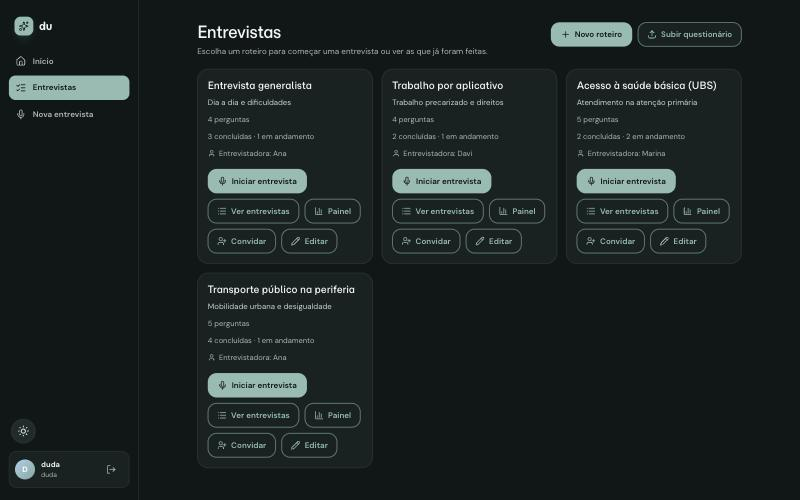 | 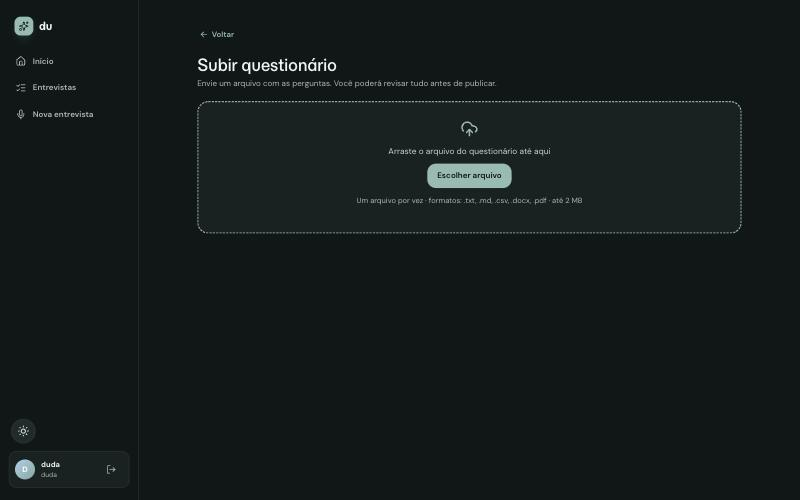 |
| Roteiros cadastrados, com contagem de entrevistas por roteiro | Upload do questionário que vira roteiro de entrevista |
| 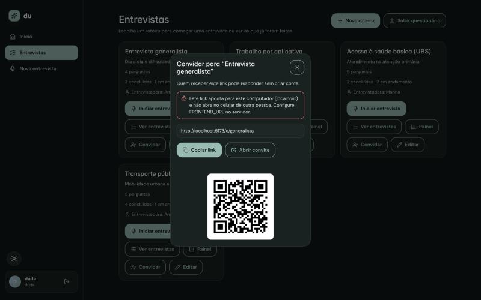 | 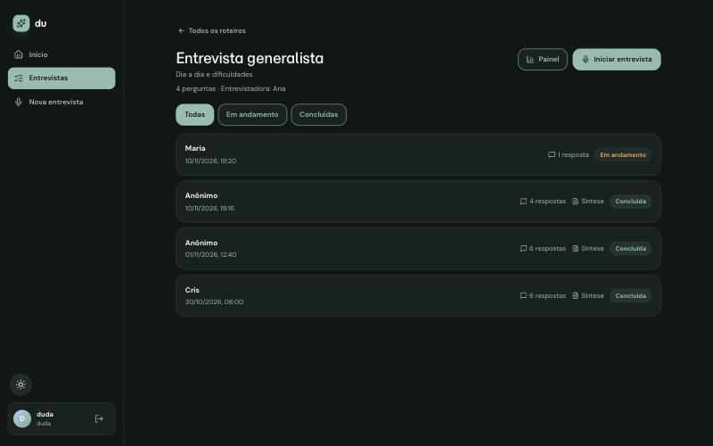 |
| Link de convite e QR code do roteiro | Entrevistas do roteiro, com filtro por status |

**Participante — responder pelo link, por voz ou por escrito**

| | |
|---|---|
| 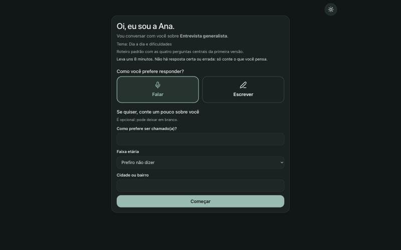 | 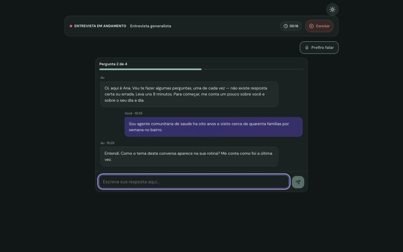 |
| Entrada sem login: escolhe falar ou escrever | Entrevista em modo texto, com o progresso no roteiro |

**Pesquisador — ler o resultado**

| | |
|---|---|
| 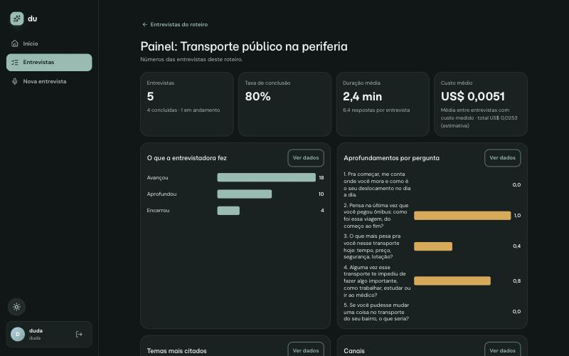 | 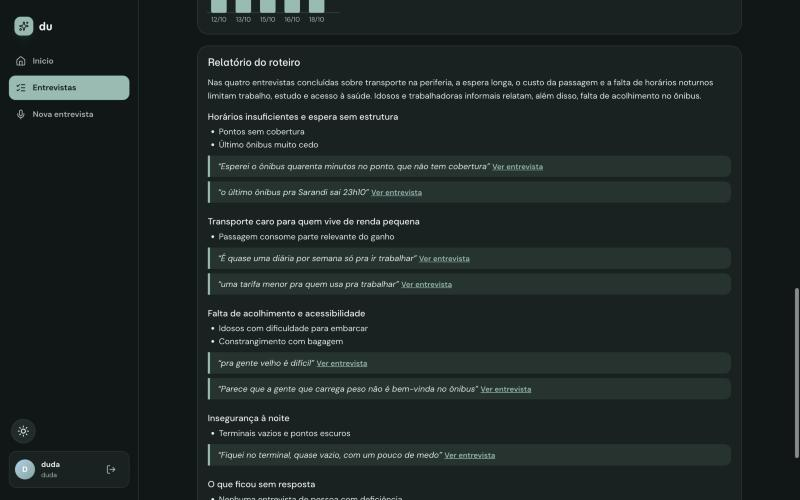 |
| Números do roteiro, incluindo custo médio por entrevista | Relatório cruzado, com citações ligadas à sessão de origem |
| 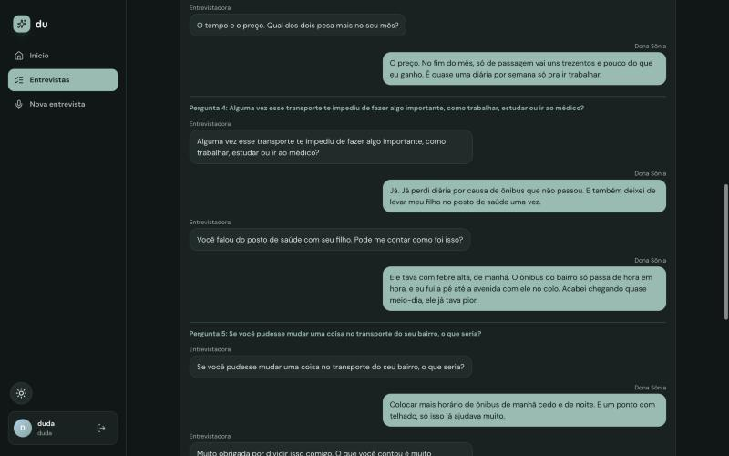 | 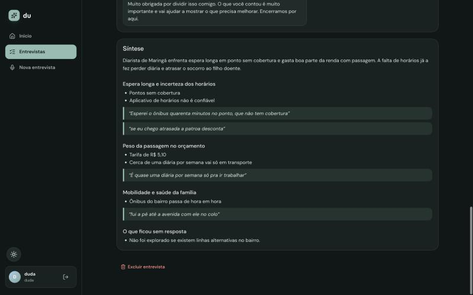 |
| Transcrição, com o aprofundamento decidido pelo LLM | Síntese da sessão: temas, citações e o que ficou sem resposta |

O visual usa tokens CSS (`src/styles/tokens.css`) com modo claro e escuro (`useTheme`, que respeita
a preferência do sistema e guarda a escolha). A voz fica em hooks (`useRecorder`, `useAudioPlayer`,
`useInterviewSession`) e todas as chamadas HTTP passam por `src/services/api.js`.

## 8. Estrutura do projeto

```
backend/
  app/
    api/deps.py         # fábricas de serviços, repositórios e providers para o Depends
    api/v1/             # router.py (prefixo /api/v1) e endpoints/ (scripts, invites, participants, session, turns, voice)
    core/               # config, usage (medidor de uso), logging, links, errors
    importing/          # extratores por formato (TextExtractor) e QuestionnaireParser
    db/                 # mongodb.py, collections.py, seed.py (roteiro padrão), demo_seed.py e demo_content.py
    prompts/            # prompts de condução, de síntese e de importação
    providers/          # LLMProvider/SpeechProvider: base, openai_provider, fake e factory
    repositories/       # BaseRepository[T] + Script, Participant, Session, Synthesis
    schemas/            # modelos Pydantic das 4 coleções, decisão do LLM, API e voz
    services/           # Script, Import, Invite, Participant, Session, Interview, Synthesis, grafo, safety
    main.py             # aplicação FastAPI, lifespan (índices + seed + migração), CORS e handlers
  scripts/seed_demo.py  # carga de dados de demonstração
  tests/                # testes automatizados e dublês (conftest.py)
frontend/
  src/
    screens/            # login, boas-vindas, roteiros, sessões, painel, editor, importação, detalhe, entrevista, convite e devolutiva
    components/         # layout, navegação, entrevista (onda, legenda, chat), editor, gráficos e tema
    hooks/              # useInterviewSession, useTurnStream, useRecorder, useAudioPlayer, useVoiceActivity, useApiResource, useTheme...
    services/api.js     # cliente HTTP único (prefixo /api/v1)
    styles/             # tokens.css (modo claro/escuro), base.css, ui.js
    utils/              # tempo.js e e2e.js
  e2e/                  # testes Playwright (6 arquivos, 9 testes)
scripts/verify-delivery.sh  # verificação determinística da entrega
docs/
  arquitetura.md, banco.md, api.md, testes.md   # documentação técnica
  EVOLUCOES.md          # spec de evoluções (EV-xx), riscos (RK-xx) e roadmap
  superpowers/plans/    # planos de implementação por fase
.claude/
  skills/entregar/      # rotina de entrega (/entregar)
  agents/               # revisor-spec, revisor-codigo, revisor-interface
.github/workflows/      # backend-ci.yml e frontend-ci.yml
```

### Modelo de dados (NoSQL)

Quatro coleções no MongoDB, ligadas por **referência** (campos `*_id`) e com **subdocumentos**
aninhados:

```
interview_scripts ◄── script_id ── interview_sessions ── participant_id ──► participants
        ▲                                   ▲
        └──────── script_id ── syntheses ── session_id ┘
```

| Coleção | Conteúdo | Objetos complexos |
|---|---|---|
| `interview_scripts` | Roteiros (`titulo`, `tema`, `slug_convite`, `ativo`, `versao`); o seed "Entrevista generalista" é criado no startup | `perguntas[]`, `persona{}`, `origem{}` |
| `participants` | Participante sem identificação obrigatória (`apelido`, `faixa_etaria`, `regiao`, `canal`) | — |
| `interview_sessions` | Estado de uma entrevista; referencia roteiro e participante | `conversation[]`, `profile{}`, `metricas{}` |
| `syntheses` | Síntese por sessão (`escopo: sessao`) ou por roteiro (`escopo: roteiro`) | `temas[]` com `citacoes[]` |

As citações só entram se forem trecho literal da fala do participante; ao apagar uma sessão, suas
os relatórios de roteiro que a usaram (`sessoes_ids` ou citação) são apagados e precisam ser regerados. Sessões da v0.1.0 são migradas no startup
de forma idempotente. Campos, exemplo real de cada coleção, índices exatos, pipelines de agregação
(`$lookup`, `$facet`) e regras de exclusão: [`docs/banco.md`](docs/banco.md).

## 9. Processo de entrega

Toda entrega segue a rotina `/entregar` (`.claude/skills/entregar/SKILL.md`): branch e commits por
item da spec, `bash scripts/verify-delivery.sh`, **três revisões independentes por agentes**
(`revisor-spec`, `revisor-codigo` e `revisor-interface`), spec (`docs/EVOLUCOES.md`) atualizada e PR
com a verificação em números e os limites abertos. Detalhes em
[`docs/testes.md`](docs/testes.md#6-processo-de-entrega).

## 10. Limites

- **Rotas do pesquisador sem autenticação** — `/scripts`, `/participants` e as rotas de sessão
  (inclusive apagar sessão e ler a transcrição) são abertas, e o CORS aceita qualquer origem.
  Resolver antes do deploy público (RK-11).
- O painel usa um `$facet`, que devolve um único documento de até 16 MB: em escala muito grande seria
  preciso pré-agregar. O relatório do roteiro usa no máximo as 30 sínteses de sessão mais recentes.
- **Rotas de convite públicas por desenho** — `/convite/{slug}`, `/convite/{slug}/sessao`,
  `GET /convite/{slug}/sessao/{session_id}` (estado mínimo da sessão) e
  `POST /convite/{slug}/sessao/{session_id}/canal` (troca voz/texto) não têm login (o participante
  entra só pelo link); quem tem o link inicia entrevistas no roteiro, sem limite de requisições (RK-15). As rotas do
  pesquisador (inclusive upload e QR) continuam sem autenticação (RK-11).
- A tela de login não autentica: apenas navega para as boas-vindas.
- O custo em `metricas` é **estimado** com preços configuráveis de referência, não é faturamento real.
- A detecção de sofrimento e de pedido de parar é por regras e pelo LLM, não um classificador clínico:
  pode errar; o acolhimento apenas indica o CVV e encerra, não substitui atendimento humano.
- Vale o que está na seção 2: transcrição, viés do modelo e dependência de microfone e conexão.
