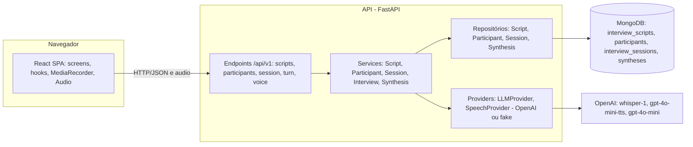
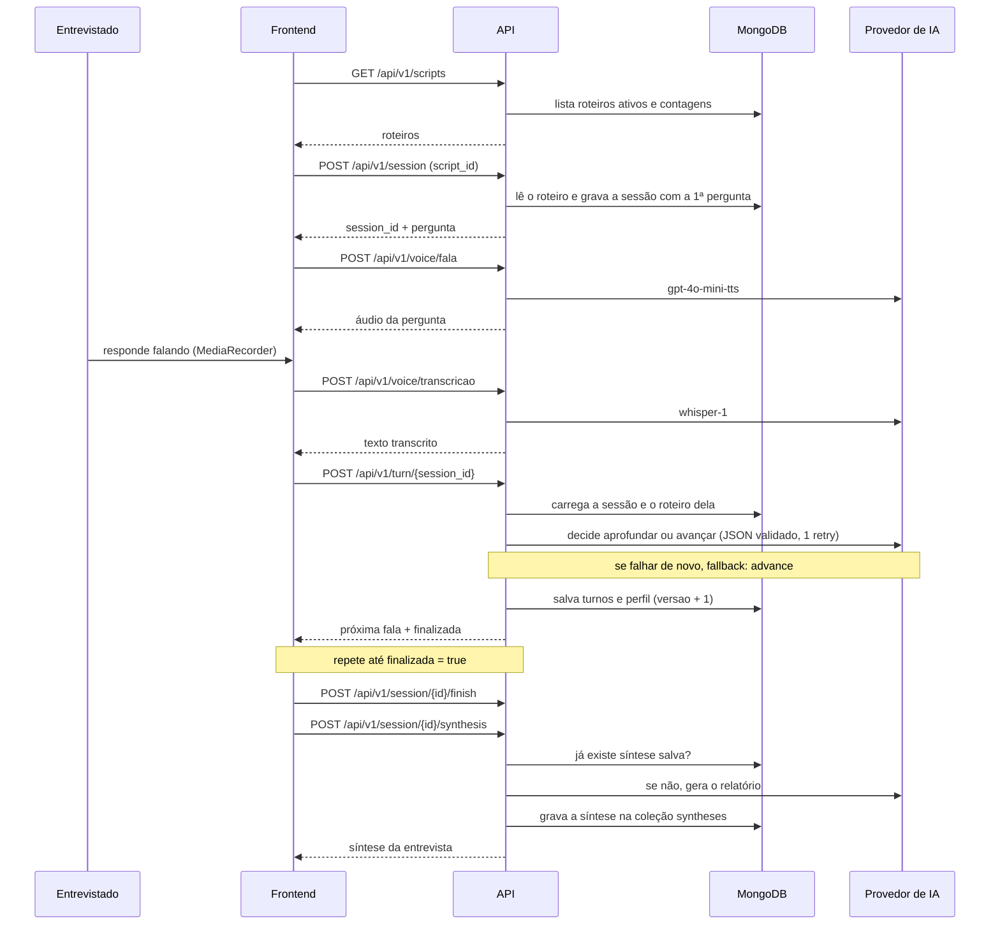
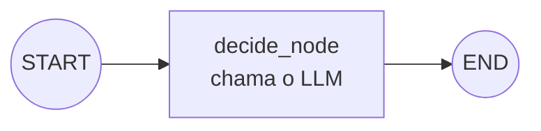
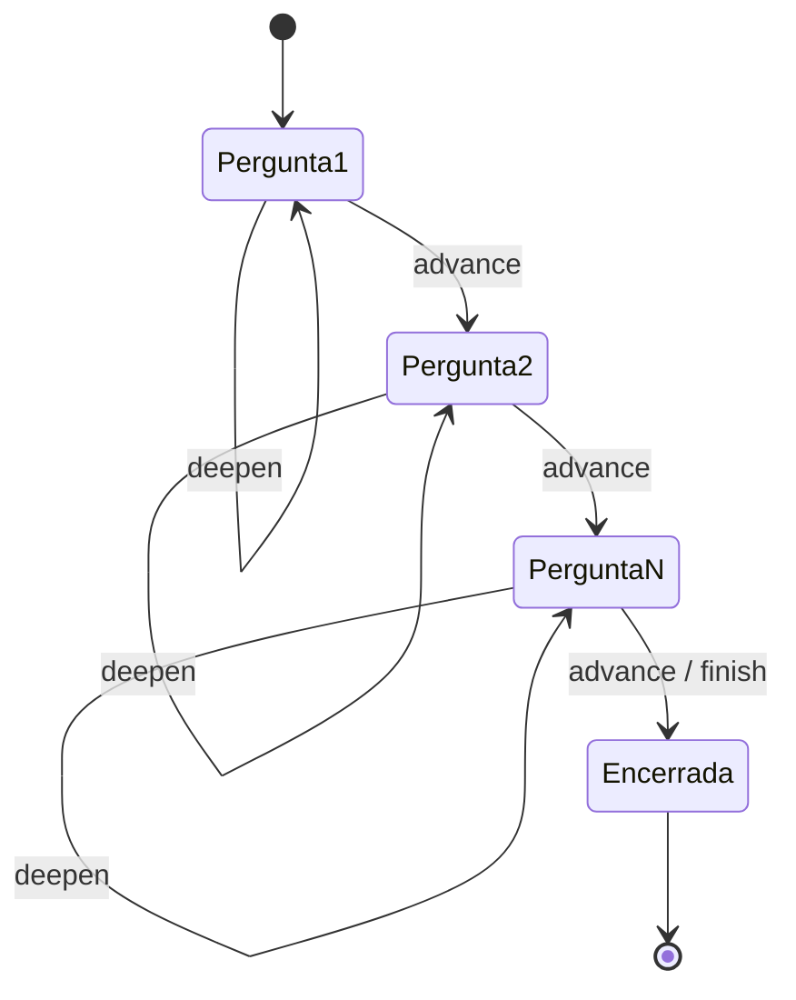

# AEP-ESOFT6SA — Interviewer

Prova de Conceito (PoC) de um **entrevistador generalista conduzido por IA e operado por voz**.
A ferramenta conduz uma entrevista em profundidade sobre qualquer tema, decide a cada resposta se
aprofunda ou avança, e entrega ao final uma síntese estruturada do que foi dito.

---

## 1. Problema

Ouvir pessoas em profundidade é caro. Uma entrevista qualitativa exige entrevistador treinado,
tempo de agenda dos dois lados, transcrição e análise — e cada entrevista adicional custa quase o
mesmo que a primeira. O resultado é que quem desenha políticas públicas, serviços, programas
sociais e pesquisas ouve **poucas pessoas**.

E não são pessoas quaisquer: são as mais fáceis de alcançar. Quem tem tempo livre, quem mora perto
dos centros urbanos, quem responde formulário online, quem escreve com desenvoltura, quem já está
na lista de contatos da organização. Quem está mais distante desse perfil — e que costuma ser
justamente quem mais depende do serviço em discussão — raramente é ouvido. Decisões que afetam
essas pessoas são tomadas a partir do relato de outras.


## 2. ODS atendida — ODS 10: Redução das Desigualdades

A PoC se alinha à **ODS 10** por duas metas específicas:

| Meta | Texto (resumido) | Como a PoC atua |
|---|---|---|
| **10.2** | Promover a inclusão social, econômica e **política** de todos, independentemente de condição econômica, deficiência ou origem | Derruba as duas barreiras que decidem quem é ouvido: o **custo por entrevista**, que cai a quase zero e permite escutar muitas pessoas em vez das mais convenientes, e a **forma de responder**, que passa a ser falar, não escrever |
| **10.3** | Garantir igualdade de oportunidades, inclusive eliminando práticas discriminatórias | Aplica o mesmo protocolo de perguntas a todos os entrevistados, sem a variação de tratamento — no tempo dedicado, no tom, no quanto se insiste — que um entrevistador humano imprime conforme a classe, o sotaque ou a aparência de quem está na frente |

### Como isso aparece na solução

- **Entrevista por voz de ponta a ponta** — a resposta é falada e transcrita
  (`POST /api/v1/voice/transcricao`), e o entrevistador responde em áudio (`POST /api/v1/voice/fala`).
  A acessibilidade não é um recurso adicional: é a forma padrão de usar o sistema. Não é preciso
  ler enunciados longos, digitar nem navegar por uma interface densa.
- **Custo marginal próximo de zero** — a entrevista roda sem entrevistador humano, o que muda a
  pergunta de "quem dá para ouvir?" para "quem precisa ser ouvido?".
- **Roteiro igual para todos** — as perguntas centrais ficam num roteiro gravado no banco
  (`interview_scripts`; o padrão "Entrevista generalista" vem de `backend/app/db/seed.py`). Elas
  são as mesmas para qualquer entrevistado do roteiro, o que torna as respostas comparáveis entre si.
- **Aprofundamento adaptativo** — a cada turno o serviço decide se aprofunda ou avança
  (`InterviewService.run_turn`). Quem responde de forma curta recebe uma nova chance de
  desenvolver, em vez de ter a fala registrada como "sem conteúdo" — o que protege exatamente
  quem não tem repertório de responder pesquisa.
- **Síntese descritiva** — o relatório final organiza o que a pessoa disse, incluindo citações
  diretas, e é instruído a **não inventar informação que não esteja na transcrição**.

### Limites e riscos assumidos

Tecnologia de IA aplicada à escuta também pode **produzir** desigualdade, e a PoC reconhece isso:

- a transcrição automática tem desempenho pior com sotaques regionais e fala fora da norma culta,
  o que degrada o registro justamente de quem se quer ouvir;
- um modelo de linguagem pode carregar viés de classe ao resumir e priorizar o que foi dito;
- o uso depende de microfone e conexão, o que exclui parte do público-alvo;
- a escuta automatizada não substitui a presença de quem conhece o território — ela amplia o
  alcance, não a profundidade do vínculo.

Por isso a síntese descreve o que foi dito e **não emite nota nem juízo sobre a pessoa
entrevistada**.

## 3. Arquitetura

### Visão geral

Três processos e um provedor externo. O frontend é uma SPA que captura e reproduz áudio no
navegador; a API concentra toda a regra de negócio e é o único ponto que fala com a OpenAI (ou com
o provider `fake`, offline); o MongoDB guarda roteiros, participantes, entrevistas e sínteses em
quatro coleções. Toda a API de negócio fica sob `/api/v1`; só `/health` fica na raiz.



### Camadas do backend

| Camada | Pasta | Responsabilidade |
|---|---|---|
| Endpoints | `app/api/v1/endpoints/` | Traduzem HTTP em chamadas de serviço (`scripts`, `participants`, `session`, `turns`, `voice`); erros de domínio viram 404/409, `ValueError` vira 400 e `ProviderError` vira 502 em `app/main.py` |
| Injeção de dependência | `app/api/deps.py` | Singletons do banco, dos 4 repositórios, dos providers e dos serviços, usados pelo `Depends` |
| Serviços | `app/services/` | Regra de negócio: `ScriptService` (edição segura e exclusão de roteiros), `ParticipantService`, `SessionService` (ciclo da sessão; liga roteiro, participante e sessão), `InterviewService` (condução da conversa), `SynthesisService` (síntese salva e regeneração) |
| Providers | `app/providers/` | Abstrações `LLMProvider` (`complete_json`, `complete_text`) e `SpeechProvider` (`transcribe`, `synthesize`); implementações OpenAI assíncronas (`OpenAILLMProvider`, `OpenAISpeechProvider`) e `Fake*` para modo offline; `factory.py` escolhe por `LLM_PROVIDER`; falhas viram `ProviderError` |
| Repositórios | `app/repositories/` | `BaseRepository[T]` genérico (CRUD, `upsert`, índices, `save` com controle otimista de `versao`) e um repositório por coleção; únicos que conhecem o Mongo |
| Esquemas | `app/schemas/` | Modelos Pydantic de entrada, saída e do estado persistido, incluindo `DecisionResult` (saída validada do LLM) |
| Banco | `app/db/` | Cliente Motor, nomes das coleções, seed do roteiro padrão e dados de demonstração |
| Importação | `app/importing/` | `TextExtractor` (classe abstrata) com uma implementação por formato (texto/markdown, CSV, DOCX, PDF), escolhida por extensão em `extractor_for`; `QuestionnaireParser` transforma o texto em rascunho de roteiro pelo LLM, com perguntas abertas |
| Convite | `app/services/invite_service.py`, `app/core/links.py` | `InviteService` serve o convite público e abre a sessão do participante; `build_invite_link` monta o link a partir de `FRONTEND_URL` |
| Prompts | `app/prompts/` | Texto dos prompts de condução e de síntese, separado do código que os executa |

Cada serviço e repositório recebe seus colaboradores pelo construtor (provider de IA, banco,
outros repositórios); quem monta tudo é `app/api/deps.py`. É isso que permite substituir OpenAI e
Mongo por dublês nos testes sem tocar em rede.

### Endpoints

Todas as rotas abaixo ficam sob `/api/v1`, exceto `GET /health` (raiz, usado pelo Compose).
`422` (corpo ou parâmetro inválido) vale para qualquer rota que recebe dados e não é repetido.

| Método | Rota | Responsabilidade | Erros principais |
|---|---|---|---|
| `GET` | `/scripts?ativos=true` | Lista roteiros com contagens (perguntas, sessões, concluídas, em andamento); `ativos=false` inclui os desativados | — |
| `POST` | `/scripts` | Cria roteiro (`201`); a ordem das perguntas é a posição na lista | — |
| `POST` | `/scripts/upload` | Questionário (multipart `file`: `.txt`, `.md`, `.csv`, `.docx`, `.pdf`) para **rascunho** de roteiro; não salva nada, a pessoa revisa e publica pelo `POST /scripts` | `413` acima de `MAX_UPLOAD_BYTES`; `415` formato não aceito; `422` arquivo ilegível, sem texto ou sem perguntas |
| `GET` | `/scripts/{script_id}` | Roteiro completo | `404` |
| `PUT` | `/scripts/{script_id}` | Edita campos, perguntas e persona | `404`; `409` roteiro padrão (não pode ser desativado nem ter perguntas alteradas), perguntas de roteiro que já tem entrevistas (concluídas ou não; crie um novo roteiro) ou versão velha |
| `DELETE` | `/scripts/{script_id}` | Sem sessões, apaga; com sessões, só desativa (`204`) | `404`; `409` roteiro padrão |
| `GET` | `/scripts/{script_id}/sessions?status=&limit=` | Resumo das sessões do roteiro (`status`: `em_andamento` ou `concluida`; `limit` 1 a 200, padrão 50) | `404` roteiro |
| `GET` | `/scripts/{script_id}/convite` | Slug e link público de convite do roteiro | `404` |
| `GET` | `/scripts/{script_id}/qrcode.svg` | QR code (SVG) do link de convite | `404` |
| `GET` | `/participants` | Lista participantes | — |
| `POST` | `/participants` | Cria participante, sem identificação obrigatória (`201`) | — |
| `GET` | `/participants/{participant_id}` | Um participante | `404` |
| `PUT` | `/participants/{participant_id}` | Atualiza campos (vale a última escrita) | `404` |
| `DELETE` | `/participants/{participant_id}` | Apaga (`204`) | `404`; `409` se tem entrevistas |
| `POST` | `/session` | Abre sessão num roteiro (corpo opcional `script_id`, `participant_id`; sem corpo usa o roteiro padrão) e devolve `session_id`, 1ª pergunta, título e total de perguntas | `404` roteiro ou participante; `409` roteiro desativado |
| `GET` | `/convite/{slug}` | **Pública.** Dados do roteiro para a tela de entrada do participante (título, tema, descrição, persona, total de perguntas, link) | `404` convite inválido ou roteiro desativado |
| `POST` | `/convite/{slug}/sessao` | **Pública.** Cria o participante (todos os campos opcionais: `canal` `voz`/`texto`, `apelido`, `faixa_etaria`, `regiao`) e abre a sessão (`201`, mesma resposta de `POST /session`) | `404` convite inválido ou encerrado |
| `GET` | `/session/{id}` | Estado completo da entrevista | `404` |
| `GET` | `/session/{id}/detalhes` | Sessão com roteiro e participante resolvidos (`$lookup`) | `404` |
| `DELETE` | `/session/{id}` | Apaga a sessão e, em cascata, a síntese dela (`204`) | `404` |
| `POST` | `/session/{id}/finish` | Encerra a entrevista (idempotente) | `404`; `409` se a sessão mudou de novo durante o encerramento |
| `POST` | `/session/{id}/synthesis?refresh=false` | Devolve a síntese salva; sem síntese (ou com `refresh=true`) gera pelo LLM e grava | `400` entrevista não encerrada; `404`; `502` LLM |
| `GET` | `/session/{id}/synthesis` | Síntese já salva (completa, com `temas`, `lacunas`, `modelo`) | `404` sessão ou síntese ainda não gerada |
| `POST` | `/turn/{id}` | Processa a resposta (`texto`) e devolve `fala`, `finalizada`, `indice_atual` | `404`; `409` entrevista encerrada ou sessão alterada por outra ação |
| `POST` | `/voice/transcricao` | Áudio (multipart `file`) para texto | `400` áudio vazio ou ininteligível; `413` acima de `MAX_AUDIO_BYTES`; `502` |
| `POST` | `/voice/fala` | Texto para áudio `audio/mpeg` | `502` |
| `GET` | `/health` (raiz) | Verificação de saúde | — |

Códigos: `400` regra de estado violada (`ValueError`) ou áudio inválido, `404` recurso inexistente,
`409` conflito de estado, `413` áudio grande demais, `502` falha do provedor de IA (inclui chave
ausente).

### Fluxo de uma entrevista

1. O frontend lista os roteiros (`GET /scripts`) e a pessoa escolhe um.
2. `POST /session` com o `script_id` abre a sessão e grava a primeira pergunta do roteiro.
3. A cada turno: a fala é transcrita, enviada em `POST /turn/{id}` e o LLM decide aprofundar,
   avançar ou encerrar; a API devolve a próxima fala e o front a reproduz em áudio.
4. Ao encerrar (`finish`), a tela de devolutiva pede a síntese; ela é gravada em `syntheses` e,
   nas próximas consultas, vem do banco sem nova chamada ao LLM.
5. **Falha do LLM no meio do turno:** a decisão é validada e tentada de novo uma vez; se continuar
   inválida ou o provedor falhar, o turno **avança para a próxima pergunta do roteiro** em vez de
   derrubar a entrevista.



### Grafo de decisão (LangGraph)

`InterviewService._build_graph` compila o grafo executado a cada turno. Estruturalmente é um
único nó — a política de condução mora inteira no `decide_node`, que lê a última resposta, chama
o LLM e devolve `deepen`, `advance` ou `finish`:



O que interessa de verdade não é a forma do grafo (um nó só), e sim **o que o resultado desse nó
dirige** em `run_turn`: o avanço pelas perguntas do roteiro escolhido (`script.perguntas`, N
perguntas, cada uma com `max_aprofundamentos`). É esse loop — fora do LangGraph, em código comum e
testável — que decide se a entrevista aprofunda, avança ou encerra:



Cada transição é decidida pelo LLM dentro do `decide_node`; o `run_turn` só aplica o efeito
(`current_index += 1`, marca `finished`, anexa o turno) e persiste o estado. Duas regras do código
corrigem o LLM: `finish` antes da última pergunta vira `advance`, e `deepen` além de
`max_aprofundamentos` da pergunta também vira `advance`.

### Decisões de projeto

- **A API não guarda estado em memória.** Todo o progresso da entrevista vive no documento do
  Mongo e é recarregado a cada turno, então qualquer instância da API atende qualquer requisição.
- **Providers atrás de abstrações.** `LLMProvider` e `SpeechProvider` isolam o SDK da OpenAI
  (cliente assíncrono, `max_retries=0`, timeout `LLM_TIMEOUT_SECONDS`); nenhum endpoint ou serviço
  o importa. Com `LLM_PROVIDER=fake`, `FakeLLMProvider` e `FakeSpeechProvider` respondem de forma
  determinística, sem rede e sem chave: serve para demo offline e para testes.
- **A decisão de condução é um grafo.** `InterviewService` compila um grafo LangGraph com o nó
  `decide`, que executa o `DECISION_PROMPT` e devolve `deepen`, `advance` ou `finish` em JSON —
  isolando a política de condução do código que aplica seus efeitos no estado.
- **A saída do LLM é validada, com retry e fallback.** O JSON vira `DecisionResult` (Pydantic:
  `action` restrito, `deepen` exige fala, `profile_updates` normalizado para texto). Resposta
  inválida ou erro do provedor gera uma segunda tentativa (`MAX_DECISION_ATTEMPTS = 2`); esgotadas,
  usa-se `FALLBACK_DECISION` (`advance`). Os logs registram só o tipo do erro, nunca o conteúdo
  da fala do participante.
- **Síntese salva (EV-13).** A síntese fica em `syntheses`; `POST /session/{id}/synthesis` devolve
  a salva sem chamar o LLM, e só `?refresh=true` gera de novo (e paga a chamada).
- **API versionada em `/api/v1`.** O frontend monta todas as URLs com esse prefixo em
  `src/services/api.js`.
- **Concorrência otimista.** Sessões e roteiros têm o campo `versao`: `BaseRepository.save` só grava
  se o documento ainda está na versão lida e, senão, levanta `ConflictError` (`409`). Um turno
  lento que termina depois de "Concluir" não reabre a entrevista; já `finish` relê e tenta de novo,
  então encerrar sempre vence.
- **Regras de exclusão preservam o histórico.** Apagar uma sessão apaga também a síntese dela, em
  cascata; roteiro com sessões é apenas desativado, e o roteiro padrão não pode ser apagado nem
  desativado; participante com entrevistas não pode ser apagado (`409`).
- **Regras de estado são checadas no servidor.** Responder a uma entrevista encerrada devolve
  `409`, e pedir a síntese antes do encerramento levanta `ValueError`, convertido em `400` pelo
  handler registrado em `app/main.py`.
- **O áudio nunca é armazenado.** A gravação vai para a transcrição e é descartada; só o texto
  persiste. O tamanho máximo é `MAX_AUDIO_BYTES` (`413` acima disso).

## 4. Tecnologias

| Camada | Stack |
|---|---|
| Backend | Python 3.11+, FastAPI, Pydantic, LangGraph; `python-docx` e `pypdf` (leitura de questionários), `segno` (QR code) |
| IA | OpenAI — `whisper-1` (transcrição), `gpt-4o-mini-tts` (voz), modelo de texto (`LLM_MODEL`, padrão `gpt-4o-mini`) para condução e síntese; provider `fake` offline |
| Banco de dados | MongoDB 7 (NoSQL), acesso assíncrono via Motor |
| Frontend | React 18, Vite, React Router, `fetch` (cliente único em `services/api.js`), tokens de design em CSS com modo claro e escuro |
| Testes | pytest, pytest-cov, mongomock-motor |
| Infra | Docker e Docker Compose |
| CI | GitHub Actions (`.github/workflows/backend-ci.yml`) |

## 5. Como executar

### Variáveis de ambiente (`backend/.env`)

| Variável | Padrão | Função |
|---|---|---|
| `MONGO_URI` | `mongodb://localhost:27017` | Conexão com o MongoDB (no Compose é sobrescrita para `mongodb://mongo:27017`) |
| `MONGO_DB` | `app_db` | Nome do banco |
| `OPENAI_API_KEY` | vazio | Chave da OpenAI (obrigatória com `LLM_PROVIDER=openai`) |
| `LLM_PROVIDER` | `openai` | `openai` (API real) ou `fake` (offline, respostas simuladas) |
| `LLM_MODEL` | `gpt-4o-mini` | Modelo de chat usado com `LLM_PROVIDER=openai` |
| `LLM_TIMEOUT_SECONDS` | `20` | Tempo máximo de cada chamada ao provedor de IA |
| `MAX_AUDIO_BYTES` | `26214400` (25 MB) | Tamanho máximo do áudio enviado para transcrição |
| `MAX_UPLOAD_BYTES` | `2097152` (2 MB) | Tamanho máximo do questionário enviado em `/scripts/upload` |
| `FRONTEND_URL` | `http://localhost:5173` | Endereço público do frontend, usado para montar o link e o QR do convite |

No frontend, `VITE_API_URL` (padrão `http://localhost:8000`) aponta para a API.

### Com Docker Compose (recomendado)

1. Crie o arquivo de ambiente do backend a partir do exemplo:

```bash
cp backend/.env.example backend/.env
```

2. Preencha `OPENAI_API_KEY` em `backend/.env`.

   **Modo offline:** para rodar sem chave da OpenAI, defina `LLM_PROVIDER=fake` em `backend/.env`:
   as respostas do entrevistador, da síntese e da voz são simuladas (determinísticas). Sem chave e
   com `LLM_PROVIDER=openai`, a API responde `502` nas rotas que dependem do provedor.

3. Suba os serviços:

```bash
docker compose up --build
```

- Frontend: http://localhost:5173
- API: http://localhost:8000 — documentação em http://localhost:8000/docs
- MongoDB: `mongodb://localhost:27017`

### Localmente, sem Docker

Backend (requer um MongoDB acessível em `MONGO_URI`):

```bash
cd backend
python -m venv .venv
.venv/bin/pip install -r requirements-dev.txt        # Windows: .venv/Scripts/pip
.venv/bin/uvicorn app.main:app --reload              # Windows: .venv/Scripts/uvicorn
```

Frontend:

```bash
cd frontend && npm install && npm run dev
```

### Dados de demonstração

Para ter roteiros, entrevistas e sínteses prontos sem fazer dezenas de entrevistas, rode a partir
de `backend/`, com `MONGO_URI` configurado:

```bash
cd backend && .venv/Scripts/python -m scripts.seed_demo           # Windows; Linux/macOS: .venv/bin/python
cd backend && .venv/Scripts/python -m scripts.seed_demo --reset   # apaga só os dados demo- e regrava
```

Cria 3 roteiros novos (transporte na periferia, UBS, trabalho por aplicativo) além do generalista,
10 participantes, 14 sessões e as sínteses (por sessão e uma por roteiro), em português e
alinhadas à ODS 10. Serve só para um banco de demonstração: parte das sessões entra no roteiro
"Entrevista generalista" e passa a contar nas totais dele, e as sínteses são texto escrito à mão
(modelo `demo`), não geradas pela IA. Todos os ids começam com `demo-`; rodar de novo não duplica nada e o `--reset`
nunca toca em dados reais.

## 6. Testes e cobertura

Os testes automatizados do backend rodam sem chamadas reais à OpenAI (providers substituídos por
dublês ou pelo `fake`) e sem MongoDB instalado: o banco é simulado em memória com
`mongomock-motor`, que executa filtros, índices únicos e pipelines de agregação.

Estado atual: **410 testes passando, 9 pulados** (os de integração, que exigem `MONGO_TEST_URI`),
**cobertura de 98,7%** (mínimo exigido: 70%, com medição de branches).

Verificação completa da entrega (pytest com cobertura mínima + build do frontend + higiene de
arquivos proibidos):

```bash
bash scripts/verify-delivery.sh             # tudo
bash scripts/verify-delivery.sh --backend   # só backend
bash scripts/verify-delivery.sh --frontend  # só frontend
```

Só os testes do backend:

```bash
cd backend && .venv/bin/python -m pytest        # Windows: .venv/Scripts/python
```

Os testes de integração (`-m mongo`) repetem índices, `$lookup` e agregações num **MongoDB real**.
Sem `MONGO_TEST_URI` eles são pulados (são os 9 acima); na CI, um container `mongo:7` os executa:

```bash
docker compose up -d mongo
cd backend && MONGO_TEST_URI=mongodb://localhost:27017 .venv/bin/python -m pytest -m mongo
```

Para reproduzir a verificação de cobertura mínima usada na CI:

```bash
cd backend && .venv/bin/python -m pytest --cov-fail-under=70
```

O relatório em HTML é gerado em `backend/htmlcov/` com:

```bash
cd backend && .venv/bin/python -m pytest --cov-report=html
```

## 7. Telas

| Rota | Tela | O que faz |
|---|---|---|
| `/` | Login | Tela de entrada; segue para `/welcome` (sem autenticação real) |
| `/welcome` | Boas-vindas | Convite para iniciar e atalho para a lista de roteiros |
| `/entrevistas` | Roteiros | Cards dos roteiros ativos com contagens; "iniciar entrevista" ou "ver entrevistas" do roteiro |
| `/entrevistas/:scriptId` | Entrevistas do roteiro | Dados do roteiro (tema, perguntas, entrevistadora), lista de sessões com filtro por status e botão para nova entrevista |
| `/sessao/:sessionId` | Detalhe da entrevista | Conversa transcrita, participante, síntese salva (ou botão para gerá-la, se ainda não existe) e exclusão da sessão |
| `/entrevista?roteiro=` | Entrevista | Conduz a entrevista por voz no roteiro indicado (sem `roteiro`, usa o padrão); ao concluir, vai para a devolutiva |
| `/roteiros/novo` | Novo roteiro | Editor para criar roteiro do zero: tema, perguntas (reordenar, editar, remover, adicionar) e entrevistadora |
| `/roteiros/importar` | Importar questionário | Envia `.txt`, `.md`, `.csv`, `.docx` ou `.pdf`, mostra o rascunho gerado e abre o editor para revisão antes de publicar |
| `/roteiros/:scriptId/editar` | Editar roteiro | Mesmo editor, com o roteiro existente |
| (modal em `/entrevistas`) | Convite | Link de convite e QR code do roteiro, com botão para copiar |
| `/e/:slug` | Convite (público) | Entrada do participante, sem login: apresenta a pesquisa, pede apelido, faixa etária e região (opcionais) e deixa escolher voz ou texto |
| `/e/:slug/entrevista` | Entrevista (pública) | Mesma entrevista, por voz ou em **modo texto** (chat digitado), para quem não pode ou não quer falar |
| `/e/:slug/obrigado` | Agradecimento | Tela final do participante |
| `/feedback` | Devolutiva | Pede e mostra a síntese da entrevista recém-concluída, com atalho para o detalhe |

O visual usa tokens CSS (`src/styles/tokens.css`) com modo claro e escuro (`useTheme`, que respeita
a preferência do sistema e guarda a escolha). A voz fica em hooks (`useRecorder`, `useAudioPlayer`,
`useInterviewSession`) e todas as chamadas HTTP passam por `src/services/api.js`.

## 8. Estrutura do projeto

```
backend/
  app/
    api/deps.py         # fábricas de serviços, repositórios e providers para o Depends
    api/v1/router.py    # monta o prefixo /api/v1
    api/v1/endpoints/   # rotas: scripts.py, invites.py, participants.py, session.py, turns.py e voice.py
    core/config.py      # configurações via variáveis de ambiente
    core/links.py       # monta o link público do convite a partir de FRONTEND_URL
    core/errors.py      # erros de domínio (NotFoundError, ConflictError, CorruptDocumentError)
    importing/          # extratores por formato (TextExtractor) e QuestionnaireParser
    db/                 # mongodb.py, collections.py, seed.py (roteiro padrão), demo_seed.py e demo_content.py
    prompts/            # prompts de condução e de síntese
    providers/          # LLMProvider/SpeechProvider: base, openai_provider, fake e factory
    repositories/       # BaseRepository[T] + Script, Participant, Session, Synthesis
    schemas/            # modelos Pydantic das 4 coleções, decisão do LLM, API e voz
    services/           # Script, Import, Invite, Participant, Session, Interview, Synthesis
    main.py             # aplicação FastAPI, lifespan (índices + seed + migração), CORS e handlers
  scripts/seed_demo.py  # carga de dados de demonstração
  tests/                # testes automatizados e dublês (conftest.py)
frontend/
  src/
    screens/            # login, boas-vindas, roteiros, sessões, detalhe, entrevista e devolutiva
    components/         # layout, navegação, avatar, estados de tela, tema
    hooks/              # useRecorder, useAudioPlayer, useInterviewSession, useApiResource, useTheme
    services/api.js     # cliente HTTP único (prefixo /api/v1)
    styles/             # tokens.css (modo claro/escuro), base.css, ui.js
    utils/              # funções auxiliares (tempo)
scripts/verify-delivery.sh  # verificação determinística da entrega
docs/
  EVOLUCOES.md          # spec de evoluções (EV-xx), riscos (RK-xx) e roadmap
  superpowers/plans/    # planos de implementação por fase
.claude/
  skills/entregar/      # rotina de entrega (/entregar)
  agents/               # revisor-spec, revisor-codigo, revisor-interface
.github/workflows/      # backend-ci.yml
```

### Modelo de dados (NoSQL)

Quatro coleções no MongoDB, ligadas por **referência** (campos `*_id`) e com **subdocumentos**
aninhados em três delas. Planejamento e decisões: `docs/superpowers/plans/2026-11-09-multi-colecao.md`.

```
interview_scripts ◄── script_id ── interview_sessions ── participant_id ──► participants
        ▲                                   ▲
        └──────── script_id ── syntheses ── session_id ┘
```

| Coleção | Conteúdo | Objetos complexos | Índices |
|---|---|---|---|
| `interview_scripts` | Roteiros: `titulo`, `tema`, `descricao`, `slug_convite`, `ativo`, `versao` (o seed "Entrevista generalista" é criado no startup) | `perguntas[]` (`ordem`, `texto`, `objetivo`, `max_aprofundamentos`), `origem{}` (`tipo`, `arquivo`), `persona{}` (`nome`, `tom`) | `script_id` único, `slug_convite` único, `ativo` |
| `participants` | Participante, sem identificação obrigatória: `apelido`, `faixa_etaria`, `regiao`, `canal` (`voz`/`texto`) | — | `participant_id` único |
| `interview_sessions` | Estado de uma entrevista; referencia roteiro (`script_id`) e participante (`participant_id`, opcional) | `conversation[]` (turnos com `pergunta_ordem`, `acao`, `latencia_ms`), `profile{}`, `metricas{}` | `session_id` único, (`script_id`, `created_at`), `participant_id` |
| `syntheses` | Síntese por sessão (`escopo: sessao`, com `session_id`) ou por roteiro (`escopo: roteiro`, sem `session_id`); `resumo`, `lacunas[]`, `modelo` | `temas[]` (`tema`, `pontos[]`, `citacoes[]` com `texto` e `session_id`) | `synthesis_id` único, `session_id`, (`script_id`, `escopo`) |

No momento só a síntese de sessão é gerada pela API; o escopo `roteiro` existe no modelo e nos
dados de demonstração, e a geração cruzada por roteiro é evolução futura (EV-33).

Documento de `interview_sessions`:

```json
{
  "session_id": "df7c97e3-...",
  "script_id": "entrevista-generalista",
  "participant_id": null,
  "asked_indices": [0],
  "current_index": 1,
  "finished": false,
  "status": "em_andamento",
  "versao": 3,
  "profile": { "ocupacao": "agente comunitária de saúde" },
  "metricas": { "tokens": 0, "segundos_audio": 0, "custo_usd": 0 },
  "conversation": [
    { "role": "interviewer", "text": "Para começar...", "timestamp": "2026-11-09T19:37:32Z", "pergunta_ordem": 1, "acao": null, "latencia_ms": null },
    { "role": "participant", "text": "Eu trabalho...", "timestamp": "2026-11-09T19:37:50Z", "pergunta_ordem": 1, "acao": null, "latencia_ms": null },
    { "role": "interviewer", "text": "Como o tema...", "timestamp": "2026-11-09T19:37:51Z", "pergunta_ordem": 2, "acao": "advance", "latencia_ms": 812 }
  ],
  "created_at": "2026-11-09T19:37:32Z",
  "updated_at": "2026-11-09T19:37:51Z"
}
```

`status` é derivado de `finished`. `versao` é o controle otimista de concorrência (também usado em
`interview_scripts`): uma gravação feita a partir de uma cópia velha da sessão (por exemplo, um
turno lento que termina depois de "Concluir") é recusada com `409` em vez de reabrir a entrevista.

Consultas que usam os relacionamentos (`app/repositories/session_repository.py`):

- `get_details`: `$lookup` sessão → roteiro → participante, numa única consulta.
- `list_summaries` e `count_by_script`: resumo das sessões e contagens por roteiro (total e
  concluídas) usados nas telas de roteiros.
- `script_stats`: pipelines com `$group`, `$unwind`, `$filter` e `$cond` — total de sessões, taxa de
  conclusão, média de respostas, distribuição de ações (`deepen`/`advance`/`finish`) e média de
  aprofundamentos por pergunta. Ainda não há rota nem tela que o exponha (base do dashboard, EV-32).

Sessões gravadas pela v0.1.0 são migradas no startup, de forma idempotente: ganham `script_id`
do roteiro generalista (que tem as mesmas quatro perguntas), `status` e `versao`, e a síntese
antiga sai do documento da sessão para `syntheses` (`modelo: "v0.1.0"`).

## 9. Processo de entrega

Toda entrega segue a rotina `/entregar` (`.claude/skills/entregar/SKILL.md`):

1. **Branch e commits** por item da spec (`feat/EV-xx-...`, Conventional Commits em português).
2. **Verificação determinística:** `bash scripts/verify-delivery.sh` (pytest com cobertura mínima de
   70%, build do frontend e checagem de arquivos proibidos).
3. **Três revisões independentes por agentes** (`.claude/agents/`): `revisor-spec` (aderência à
   spec e à AEP), `revisor-codigo` (backend, providers, Mongo, testes) e `revisor-interface`
   (frontend, quando a mudança o toca). Achados P1/P2 são corrigidos com teste.
4. **Spec atualizada:** `docs/EVOLUCOES.md` marca os itens como concluídos e registra decisões e
   riscos; os planos de implementação ficam em `docs/superpowers/plans/`.
5. **PR** com a verificação em números e os limites que seguem abertos.

## 10. Limites

- **Rotas do pesquisador sem autenticação** — `/scripts`, `/participants` e as rotas de sessão
  (inclusive apagar sessão e ler a transcrição) são abertas, e o CORS aceita qualquer origem.
  Resolver antes do deploy público (RK-11).
- Só a síntese por sessão é gerada; síntese cruzada por roteiro e dashboard são fases seguintes
  (`docs/EVOLUCOES.md`).
- **Rotas de convite públicas por desenho** — `/convite/{slug}` e `/convite/{slug}/sessao` não têm login
  (o participante entra só pelo link); quem tem o link inicia entrevistas no roteiro. As rotas do
  pesquisador (inclusive upload e QR) continuam sem autenticação (RK-11).
- A tela de login não autentica: apenas navega para as boas-vindas.
- `metricas` da sessão (tokens, áudio, custo) existem no modelo, mas ficam zeradas (EV-62), e a
  `persona` do roteiro ainda não entra no prompt (EV-21).
- Vale o que está na seção 2: transcrição, viés do modelo e dependência de microfone e conexão.
