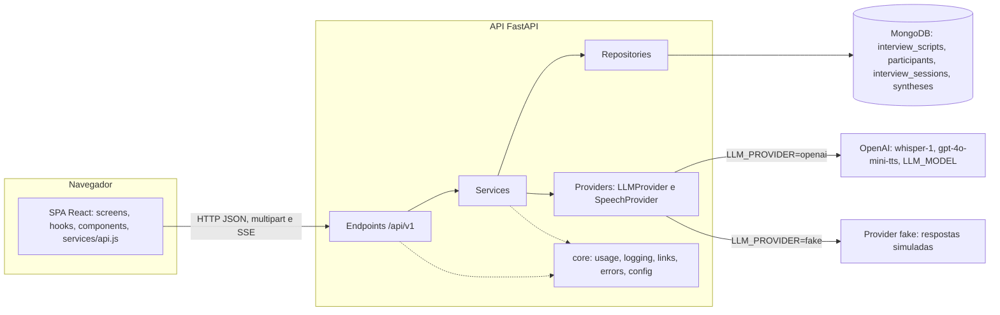
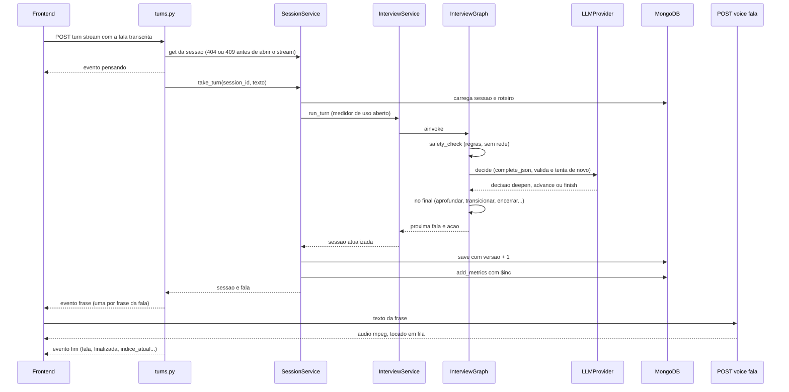
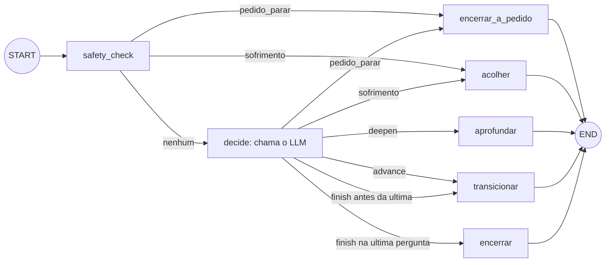

# Arquitetura

Documento técnico da PoC "Interviewer". Tudo o que está aqui foi conferido contra o código
(`backend/app/`, `frontend/src/`). Para o banco veja [banco.md](banco.md), para as rotas
[api.md](api.md) e para os testes [testes.md](testes.md).

## 1. Visão geral

A solução tem três processos e um provedor externo opcional:

| Componente | O que é | Onde está |
|---|---|---|
| **SPA React** | Interface do pesquisador e do participante; grava áudio (MediaRecorder), reproduz a fala e conversa só com a API | `frontend/` (React 18, Vite, React Router) |
| **API FastAPI** | Toda a regra de negócio, validação, acesso ao banco e chamadas a IA; sem estado em memória | `backend/app/` (Python 3.11+) |
| **MongoDB 7** | Quatro coleções: `interview_scripts`, `participants`, `interview_sessions`, `syntheses` | acesso assíncrono via Motor |
| **Provedor de IA** | `openai` (`whisper-1`, `gpt-4o-mini-tts`, modelo de texto `LLM_MODEL`) ou `fake` (offline, determinístico, sem chave) | `backend/app/providers/` |

Toda a API de negócio fica sob o prefixo `/api/v1` (`app/api/v1/router.py`); só `GET /health`
fica na raiz. O Swagger interativo está em `/docs`.

## 2. Camadas do backend

O fluxo é sempre `endpoint -> service -> repository -> MongoDB`, e os serviços que precisam de
IA falam com um `provider`. Cada classe recebe os colaboradores pelo construtor; quem monta tudo é
`app/api/deps.py` (singletons com `lru_cache`, usados via `Depends`). É isso que permite trocar
OpenAI e Mongo por dublês nos testes.

| Camada | Pasta | Módulos reais e responsabilidade |
|---|---|---|
| Endpoints | `app/api/v1/endpoints/` | `scripts.py`, `participants.py`, `session.py`, `turns.py`, `voice.py`, `invites.py`: traduzem HTTP em chamadas de serviço, sem regra de negócio |
| Handlers de erro | `app/main.py` | `NotFoundError` vira 404, `ConflictError` 409, `FileTooLargeError` 413, `UnsupportedFileError` 415, `ImportFileError` 422, `ValueError` 400, `ProviderError` 502, `CorruptDocumentError` 500; também CORS, middleware de log e `lifespan` (índices, seed e migração) |
| Services | `app/services/` | `ScriptService`, `ParticipantService`, `SessionService` (ciclo da sessão; liga roteiro, participante e sessão), `InterviewService` (conduz a conversa), `SynthesisService`, `InviteService`, `ImportService`; `interview_graph.py` (grafo), `safety.py` (checagem de segurança), `citation_check.py` (citações literais) |
| Providers | `app/providers/` | `base.py` (`LLMProvider.complete_json`/`complete_text`, `SpeechProvider.transcribe`/`synthesize`, `ProviderError`), `openai_provider.py` (`OpenAILLMProvider`, `OpenAISpeechProvider`, cliente assíncrono com `max_retries=0`), `fake.py`, `factory.py` (escolhe por `LLM_PROVIDER`) |
| Repositories | `app/repositories/` | `base.py` (`BaseRepository[T]`: CRUD, `upsert`, índices, `save` com `versao`) e `script_`, `participant_`, `session_`, `synthesis_repository.py`; são os únicos que conhecem o Mongo |
| Schemas | `app/schemas/` | Modelos Pydantic dos documentos (`script.py`, `participant.py`, `interview.py`, `synthesis.py`), da API (`api.py`, `voice.py`) e da saída validada do LLM (`decision.py`) |
| Core | `app/core/` | `config.py` (variáveis de ambiente), `usage.py` (medidor de uso em `ContextVar`), `logging.py` (log JSON), `links.py` (`build_invite_link`), `errors.py` (erros de domínio) |
| Banco | `app/db/` | `mongodb.py` (cliente Motor), `collections.py` (nomes das coleções), `seed.py` (roteiro padrão), `demo_seed.py` e `demo_content.py` (dados de demonstração) |
| Importação | `app/importing/` | `extractors.py` (um extrator por formato: texto/markdown, CSV, DOCX, PDF) e `questionnaire_parser.py` (rascunho de roteiro pelo LLM) |
| Prompts | `app/prompts/` | `interview_prompts.py`, `synthesis_prompts.py`, `import_prompts.py`: texto dos prompts separado do código |

### Core

- **Uso e custo (`usage.py`)**: `UsageMeter` acumula tokens de entrada/saída do LLM, segundos de
  áudio (STT) e caracteres de TTS. O medidor vive numa `ContextVar` aberta por `track_usage()`;
  os providers somam nele sem saber de sessão. Ao fim da operação,
  `record_usage_safely` chama `SessionRepository.add_metrics` (um `$inc` atômico) e nunca
  levanta erro. O custo é estimado por `estimate_cost` com preços configuráveis em `Settings`.
- **Log (`logging.py`)**: uma linha JSON por requisição em stdout; só os campos de `EXTRA_FIELDS`
  (`request_id`, `method`, `path`, `status`, `duration_ms`, `session_id`, `stage`, `error_type`).
  Nunca o conteúdo da fala. O `path` é o modelo da rota, sem ids; o `request_id` volta no
  cabeçalho `X-Request-ID`.
- **Links (`links.py`)**: `build_invite_link(slug)` devolve `FRONTEND_URL/e/{slug}`.
- **Erros (`errors.py`)**: hierarquia de `DomainError` com mensagem pronta em português.

## 3. Um turno em streaming

O frontend usa `POST /api/v1/turn/{session_id}/stream` (SSE). O LLM é chamado **uma vez** por
turno; o turno é gravado antes da primeira frase sair, e a gravação roda numa task protegida
(`asyncio.shield`): se o cliente desconectar, a resposta dele não se perde.

Pontos conferidos no código:

1. `handle_turn_stream` busca a sessão antes de abrir o stream: sessão inexistente dá `404` e
   encerrada dá `409` como HTTP normal. Falhas depois do início viram o evento `erro`.
2. O evento `pensando` sai antes de o LLM responder. Depois do turno pronto, `split_sentences`
   divide a fala em frases (sem quebrar abreviações como "Dr." nem decimais) e cada uma sai como
   evento `frase`, com `finalizada` já conhecida; o `fim` repete o corpo de `POST /turn/{id}`.
3. Não é streaming token a token: o streaming é por frase, depois da decisão pronta.
4. No front, `useInterviewSession` chama `api.synthesizeSpeech` (`POST /voice/fala`) para cada
   frase e as enfileira em `useAudioPlayer`; se a síntese falhar a frase segue só pela legenda.
   Em modo texto as frases são reveladas por `useTypewriter`.
5. `take_turn` abre o medidor de uso dentro do serviço, e não no endpoint, para valer também
   na task protegida do SSE; o consumo é gravado mesmo se o turno falhar.

## 4. O grafo de decisão (LangGraph)

`InterviewGraphBuilder` (`app/services/interview_graph.py`) compila o grafo executado a cada
turno por `InterviewService.run_turn`. A checagem de segurança é determinística
(`safety.py`, sem rede); o único nó que chama o LLM é `decide`.

- `route_safety` e `route_decision` (métodos estáticos do builder) fazem o roteamento.
- `aprofundar`: se a pergunta já usou `max_aprofundamentos`, descarta a fala do LLM e age como
  `transicionar` (o grafo não tem aresta para isso: o nó chama o método).
- `transicionar` avança `current_index`; se passou da última pergunta, fecha a entrevista.
- `encerrar_a_pedido` e `acolher` marcam `finished`; `acolher` guarda só `profile.alerta =
  "acolhimento"` (nunca o texto da pessoa) e cita o CVV (188, cvv.org.br).
- `finish` antes da última pergunta vira `advance`: nada se perde.
- A decisão do LLM vira `DecisionResult` (Pydantic). Resposta inválida ou `ProviderError`
  gera uma segunda tentativa (`MAX_DECISION_ATTEMPTS = 2`); esgotadas, usa-se
  `FALLBACK_DECISION` (`advance`). Os logs registram só o tipo do erro.

## 5. Estrutura do frontend

React 18 + Vite; sem biblioteca de estado global. Todas as chamadas HTTP passam por
`src/services/api.js` (usa `fetch`, prefixo `/api/v1`, classe `ApiError`). Os tokens de design
ficam em `src/styles/tokens.css`, com modo claro e escuro (`useTheme`).

| Pasta | Conteúdo real |
|---|---|
| `src/screens/` | `LoginScreen`, `WelcomeScreen`, `ScriptsScreen`, `ScriptSessionsScreen`, `ScriptDashboardScreen`, `ScriptEditorScreen`, `ScriptImportScreen`, `SessionDetailScreen`, `InterviewScreen` (privada e pública), `InviteScreen`, `ThankYouScreen`, `FeedbackScreen` |
| `src/hooks/` | `useInterviewSession` (orquestra o turno), `useTurnStream` (lê o SSE), `useRecorder`, `useAudioPlayer`, `useVoiceActivity`, `useTypewriter`, `useFillers`, `useElapsedTime`, `useApiResource`, `useTheme` |
| `src/components/` | `Layout`, `PublicLayout`, `NavBar`, `SideBar`, `Avatar`, `Waveform`, `LiveCaption`, `ChatComposer`, `TranscriptConfirm`, `InterviewProgress`, `InviteModal`, `QuestionListEditor`, `FileDrop`, `ScriptSynthesis`, `StatusBadge`, `EstadoTela`, `ThemeToggle`, `Pointer` e `charts/` (`BarChart`, `DataTable`, `StatTile`) |
| `src/utils/` | `tempo.js` (atrasos de realismo) e `e2e.js` (`VITE_E2E=1` desliga atrasos nos testes) |
| `e2e/` | Testes Playwright (veja [testes.md](testes.md)) |

As rotas estão em `src/App.jsx`; a tabela de telas por rota está no [README](../README.md#7-telas).

## 6. Decisões de projeto e por quê

- **Uma chamada ao LLM por turno.** Controla custo e latência e simplifica o modelo mental: o nó
  `decide` devolve ação, fala e atualizações de perfil num só JSON; o resto do grafo é
  determinístico.
- **Segurança conservadora.** O atalho determinístico (`safety.py`) só encerra em pedido claro e
  curto, e pergunta nunca encerra: um falso positivo (encerrar sem a pessoa pedir) é pior que
  um falso negativo, porque o LLM ainda pode devolver `pedido_parar`. Sofrimento sempre
  acolhe e encerra, e só o tipo do alerta é gravado.
- **Saída do LLM validada, com retry e fallback.** Nenhum JSON do modelo entra no sistema sem
  passar por Pydantic; a entrevista nunca cai por causa do LLM.
- **Citações literais.** Na síntese, `citation_check.py` só aceita citação que seja trecho
  literal da fala do participante (guardada como o trecho original) e, no relatório do roteiro,
  só citação que já consta nas sínteses de sessão (`filter_known_citations`); assim o relatório
  não inventa o que a pessoa disse.
- **Concorrência otimista.** Sessões e roteiros têm `versao`: `BaseRepository.save` só grava se
  a versão lida ainda é a do banco, senão `ConflictError` (409). Um turno lento que termina
  depois de "Concluir" não reabre a entrevista; `finish` relê e tenta de novo, então encerrar
  sempre vence.
- **Medidor de uso em `ContextVar`.** Os providers somam consumo sem conhecer sessão nem
  repositório; o consumo é gravado por `$inc` atômico, sem tocar em `versao`.
- **Provider `fake`.** Com `LLM_PROVIDER=fake`, `FakeLLMProvider` e `FakeSpeechProvider`
  respondem de forma determinística, sem rede nem chave: serve para demo offline e para os
  testes E2E.
- **Sem estado em memória na API.** O progresso vive no documento da sessão e é recarregado a
  cada turno; qualquer instância atende qualquer requisição.
- **O áudio nunca é armazenado.** A gravação vai para a transcrição e é descartada; só o texto
  persiste (limite `MAX_AUDIO_BYTES`).
- **API versionada.** Tudo em `/api/v1`; o front monta as URLs com esse prefixo.
