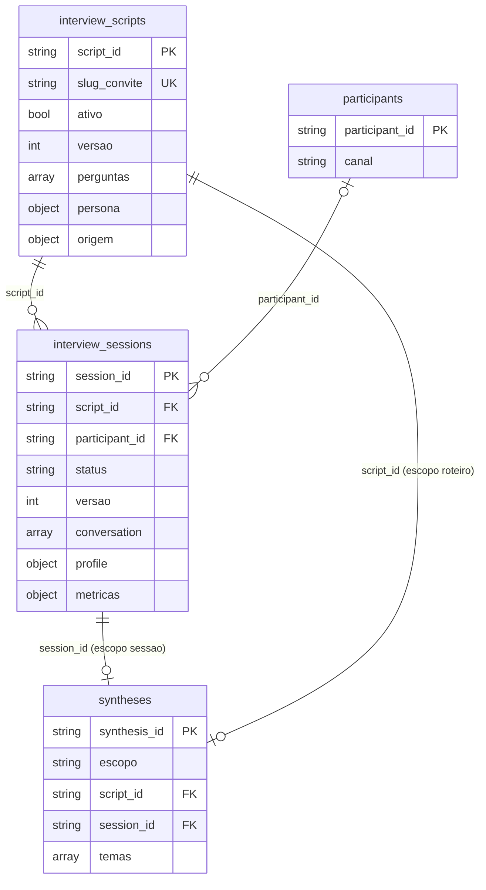

# Banco de dados (MongoDB)

Estrutura, índices e consultas do banco da PoC. Conferido contra os modelos Pydantic
(`backend/app/schemas/`) e os repositórios (`backend/app/repositories/`). Os exemplos de
documento vêm do seed de demonstração (`backend/app/db/demo_seed.py` e `demo_content.py`),
encurtados com "…" onde são longos.

- **SGBD:** MongoDB 7 (NoSQL orientado a documentos), acesso assíncrono pelo driver Motor.
- **Banco:** `MONGO_DB` (padrão `app_db`); o E2E usa `aep_e2e`.
- **Nomes das coleções:** `backend/app/db/collections.py`.
- **Validação:** não há schema no servidor; todo documento é validado pelo modelo Pydantic ao
  ler e ao gravar (`BaseRepository._to_model`). Documento fora do modelo vira
  `CorruptDocumentError` (500) com só coleção, campo e tipo do erro, nunca o valor.

## 1. Visão geral e relacionamentos



Os relacionamentos são por **referência** (campos `*_id`), resolvidos com `$lookup` onde
precisa de junção. Os dados que só fazem sentido dentro de um documento são **subdocumentos**
(`perguntas[]`, `persona{}`, `conversation[]`, `metricas{}`, `temas[]`).

| Relação | Cardinalidade | Observação |
|---|---|---|
| `interview_sessions.script_id` -> `interview_scripts.script_id` | N:1 | toda sessão pertence a um roteiro |
| `interview_sessions.participant_id` -> `participants.participant_id` | N:1, opcional | pode ser `null` (entrevista sem identificação) |
| `syntheses.session_id` -> `interview_sessions.session_id` | 1:1 por sessão | só no `escopo: "sessao"`; id fixo `sessao:{session_id}` |
| `syntheses.script_id` -> `interview_scripts.script_id` | 1:1 por roteiro | no `escopo: "roteiro"` (sem `session_id`); id fixo `roteiro:{script_id}` |

## 2. Coleções

Datas são `datetime` UTC. `status` é derivado (`@computed_field`) e gravado no documento.

### 2.1 `interview_scripts` (modelo `InterviewScript`)

| Campo | Tipo | Notas |
|---|---|---|
| `script_id` | string | identidade; uuid, ou `entrevista-generalista` no seed |
| `titulo` | string (min 1) | |
| `tema`, `descricao` | string | padrão `""` |
| `origem` | subdocumento `ScriptOrigin` | `tipo` (`manual` \| `upload`), `arquivo` (string ou null), `extraido_em` (data ou null) |
| `perguntas` | array de `Question` (min 1) | `ordem` (int >= 1, única no roteiro; ordenadas), `texto` (string), `objetivo` (string), `max_aprofundamentos` (int 0 a 5, padrão 2) |
| `persona` | subdocumento `Persona` | `nome` (padrão `Ana`), `tom` (`acolhedor` \| `neutro` \| `formal`) |
| `slug_convite` | string | gerado de `titulo` + 8 primeiros caracteres do id se vazio; único |
| `ativo` | bool | padrão `true`; desativar preserva o histórico |
| `versao` | int >= 0 | controle otimista de concorrência |
| `created_at`, `updated_at` | datetime | |

Exemplo (`demo-saude`, perguntas 2 a 4 omitidas):

```json
{
  "script_id": "demo-saude",
  "titulo": "Acesso à saúde básica (UBS)",
  "tema": "Atendimento na atenção primária",
  "descricao": "Roteiro importado do questionário da secretaria de saúde sobre o uso das Unidades Básicas de Saúde.",
  "origem": { "tipo": "upload", "arquivo": "questionario-ubs.docx", "extraido_em": "2026-10-06T10:30:00Z" },
  "perguntas": [
    { "ordem": 1, "texto": "Pra começar, me fala um pouco de você e de como você costuma cuidar da sua saúde.",
      "objetivo": "Conhecer a pessoa e seus hábitos de cuidado.", "max_aprofundamentos": 1 },
    "…",
    { "ordem": 5, "texto": "O que faria o atendimento da UBS ser melhor pra você e pra sua família?",
      "objetivo": "Levantar melhorias sugeridas pelo usuário.", "max_aprofundamentos": 1 }
  ],
  "persona": { "nome": "Marina", "tom": "acolhedor" },
  "slug_convite": "saude-basica-ubs",
  "ativo": true,
  "versao": 0,
  "created_at": "2026-10-06T10:30:00Z",
  "updated_at": "2026-10-06T10:30:00Z"
}
```

O roteiro padrão "Entrevista generalista" (`script_id: entrevista-generalista`, slug
`generalista`, 4 perguntas) é gravado no startup por `ScriptRepository.ensure_seed`, com
`$setOnInsert`: não sobrescreve edições posteriores.

### 2.2 `participants` (modelo `Participant`)

| Campo | Tipo | Notas |
|---|---|---|
| `participant_id` | string | identidade (uuid) |
| `apelido`, `faixa_etaria`, `regiao` | string ou null | todos opcionais: ninguém precisa se identificar |
| `canal` | `voz` \| `texto` | padrão `voz` |
| `created_at`, `updated_at` | datetime | |

Exemplo (`demo-p01`):

```json
{
  "participant_id": "demo-p01",
  "apelido": "Dona Sônia",
  "faixa_etaria": "45-54",
  "regiao": "Jardim Alvorada, Maringá",
  "canal": "voz",
  "created_at": "2026-10-12T10:10:00Z",
  "updated_at": "2026-10-12T10:10:00Z"
}
```

### 2.3 `interview_sessions` (modelo `InterviewState`)

| Campo | Tipo | Notas |
|---|---|---|
| `session_id` | string | identidade (uuid) |
| `script_id` | string | referência ao roteiro (padrão `entrevista-generalista`) |
| `participant_id` | string ou null | referência ao participante |
| `asked_indices` | array de int | índices das perguntas já concluídas |
| `current_index` | int | posição da pergunta atual em `script.perguntas` |
| `conversation` | array de `Turn` | `role` (`interviewer` \| `participant`), `text`, `timestamp`, `pergunta_ordem` (int ou null), `acao` (`deepen` \| `advance` \| `finish` ou null), `latencia_ms` (int >= 0 ou null) |
| `profile` | objeto string -> string | perfil extraído pelo LLM; `alerta` guarda só o tipo do alerta de segurança |
| `metricas` | subdocumento `SessionMetrics` | `llm_input_tokens`, `llm_output_tokens`, `stt_seconds`, `tts_chars`, `tokens`, `segundos_audio`, `custo_usd` |
| `finished` | bool | |
| `status` | `em_andamento` \| `concluida` | derivado de `finished` |
| `versao` | int >= 0 | controle otimista |
| `created_at`, `updated_at` | datetime | |

Exemplo (`demo-s01`, conversa com 17 falas, mostradas 3):

```json
{
  "session_id": "demo-s01",
  "script_id": "demo-transporte",
  "participant_id": "demo-p01",
  "asked_indices": [0, 1, 2, 3, 4],
  "current_index": 5,
  "conversation": [
    { "role": "interviewer", "text": "Oi, eu sou Ana. Obrigada por aceitar conversar comigo, …",
      "timestamp": "2026-10-12T10:15:00Z", "pergunta_ordem": 1, "acao": null, "latencia_ms": null },
    { "role": "participant", "text": "Eu moro no Jardim Alvorada, aqui em Maringá. Trabalho de diarista, …",
      "timestamp": "2026-10-12T10:15:19Z", "pergunta_ordem": 1, "acao": null, "latencia_ms": null },
    { "role": "interviewer", "text": "Pensa na última vez que você pegou ônibus: como foi essa viagem, do começo ao fim?",
      "timestamp": "2026-10-12T10:15:24.567000Z", "pergunta_ordem": 2, "acao": "advance", "latencia_ms": 3067 },
    "…"
  ],
  "profile": { "ocupacao": "diarista", "contexto": "mora no Jardim Alvorada e usa ônibus duas vezes ao dia", "sentimento": "cansada, mas resignada" },
  "metricas": { "llm_input_tokens": 0, "llm_output_tokens": 0, "stt_seconds": 0.0, "tts_chars": 0,
                "tokens": 1544, "segundos_audio": 80.0, "custo_usd": 0.0094 },
  "finished": true,
  "status": "concluida",
  "versao": 0,
  "created_at": "2026-10-12T10:15:00Z",
  "updated_at": "2026-10-12T10:18:07.125000Z"
}
```

(Nas sessões reais, as métricas detalhadas `llm_input_tokens`, `llm_output_tokens` e
`tts_chars` são preenchidas pelo medidor; o seed grava só os totais.)

### 2.4 `syntheses` (modelo `Synthesis`)

| Campo | Tipo | Notas |
|---|---|---|
| `synthesis_id` | string | identidade fixa: `sessao:{session_id}` ou `roteiro:{script_id}` |
| `escopo` | `sessao` \| `roteiro` | |
| `script_id` | string | referência ao roteiro |
| `session_id` | string ou null | obrigatório se `escopo = sessao`, proibido se `roteiro` (validado no modelo) |
| `resumo` | string | |
| `temas` | array de `Theme` | `tema`, `pontos[]` (strings), `citacoes[]` (`texto`, `session_id`) |
| `divergencias`, `lacunas` | array de string | `divergencias` só no relatório do roteiro |
| `sessoes_usadas` | int | quantas sínteses de sessão alimentaram o relatório do roteiro |
| `sessoes_ids` | array de string | ids das sessões usadas no relatório do roteiro; serve para apagar o relatório se uma delas for excluída (relatório antigo sem o campo também é apagado) |
| `metricas` | `SessionMetrics` | consumo e custo da geração do relatório do roteiro; somado ao `custo_total_usd` do painel |
| `modelo` | string | modelo que gerou (`demo` no seed, `v0.1.0` nas migradas) |
| `created_at`, `updated_at` | datetime | |

Exemplo (`sessao:demo-s01`, temas encurtados):

```json
{
  "synthesis_id": "sessao:demo-s01",
  "escopo": "sessao",
  "script_id": "demo-transporte",
  "session_id": "demo-s01",
  "resumo": "Diarista de Maringá enfrenta espera longa em ponto sem cobertura e gasta boa parte da renda com passagem. …",
  "temas": [
    { "tema": "Espera longa e incerteza dos horários",
      "pontos": ["Pontos sem cobertura", "Aplicativo de horários não é confiável"],
      "citacoes": [
        { "texto": "Esperei o ônibus quarenta minutos no ponto, que não tem cobertura", "session_id": "demo-s01" },
        "…"
      ] },
    "…"
  ],
  "divergencias": [],
  "lacunas": ["Não foi explorado se existem linhas alternativas no bairro."],
  "sessoes_usadas": 0,
  "modelo": "demo",
  "created_at": "2026-10-12T10:20:07.125000Z",
  "updated_at": "2026-10-12T10:20:07.125000Z"
}
```

O relatório do roteiro tem a mesma forma, com `synthesis_id: "roteiro:demo-transporte"`,
`escopo: "roteiro"`, `session_id: null` e citações de várias sessões (por exemplo
`demo-s01`, `demo-s02`, `demo-s05`). No relatório do seed, `sessoes_usadas` é o número de sessões distintas citadas e `sessoes_ids` lista os ids delas; `sessoes_usadas: 0` acima é o valor de uma síntese de sessão.

## 3. Índices

Todos criados no startup por `BaseRepository.ensure_indexes` (`app/main.py`,
`prepare_database`). O índice de identidade é único e se chama `{campo}_unico`; os demais vêm
de `extra_indexes` de cada repositório.

| Coleção | Nome | Chaves | Único | Para que serve |
|---|---|---|---|---|
| `interview_scripts` | `script_id_unico` | `script_id` asc | sim | identidade |
| | `slug_convite_unico` | `slug_convite` asc | sim | convite público por slug |
| | `ativo` | `ativo` asc | não | listar roteiros ativos |
| `participants` | `participant_id_unico` | `participant_id` asc | sim | identidade |
| `interview_sessions` | `session_id_unico` | `session_id` asc | sim | identidade |
| | `script_id_data` | `script_id` asc, `created_at` desc | não | sessões de um roteiro, por data de criação |
| | `script_id_atualizada` | `script_id` asc, `updated_at` desc | não | listagem de resumos (mais recentes primeiro) |
| | `participant_id` | `participant_id` asc | não | checagem de exclusão do participante (`has_for_participant`) e listagem por participante |
| `syntheses` | `synthesis_id_unico` | `synthesis_id` asc | sim | identidade; garante uma síntese por sessão e por roteiro mesmo com pedidos simultâneos |
| | `session_id` | `session_id` asc | não | `$lookup` e exclusão em cascata |
| | `script_id_escopo` | `script_id` asc, `escopo` asc | não | sínteses de sessão de um roteiro |

O teste de integração `test_indexes_exist_in_the_server` confere isso num MongoDB real.

## 4. Consultas e agregações

Todas em `app/repositories/session_repository.py`, salvo indicação.

**Contagens por roteiro (`count_by_script`)**, usada em `GET /scripts`:
1. `$match` das sessões com `script_id` em `$in` os roteiros pedidos;
2. `$group` por `script_id` com `total` (`$sum: 1`) e `concluidas` (`$sum` de `$cond` sobre
   `finished`).
`em_andamento` é `total - concluidas`, calculado em `ScriptService.list_summaries`.

**Resumo das sessões do roteiro (`list_summaries`)**, usada em `GET /scripts/{id}/sessions`:
1. `$match` por `script_id` (e `status`, se informado);
2. `$sort` por `updated_at` desc e `session_id`, e `$limit`;
3. `$lookup` em `participants` (por `participant_id`) para o apelido;
4. `$lookup` em `syntheses` (por `session_id`) para saber se há síntese;
5. `$project` com `respostas` (`$size` de `$filter` das falas com `role = participant`) e
   `tem_sintese` (existe síntese com `escopo = sessao`).

**Detalhes da sessão (`get_details`)**, usada em `GET /session/{id}/detalhes`:
`$match` por `session_id`, dois `$lookup` (`interview_scripts` por `script_id` e
`participants` por `participant_id`), dois `$unwind` com `preserveNullAndEmptyArrays` (roteiro
apagado ou participante ausente não derrubam a consulta), `$project` sem `_id` e `$limit: 1`.

**Painel do roteiro (`script_dashboard`)**, usada em `GET /scripts/{id}/painel`. Um `$match` por
`script_id` seguido de um `$facet` com seis ramos, todos calculados no banco:

| Ramo | Passos |
|---|---|
| `resumo` | `$group` único: total, concluídas, média de respostas (`$avg` do `$size` do `$filter`), soma da duração das concluídas (`$subtract` de `updated_at` e `created_at`), custo (`$sum` de `metricas.custo_usd`) e quantas sessões têm custo |
| `acoes` | `$unwind` de `conversation`, `$match` das ações `deepen`/`advance`/`finish`, `$group` por ação, `$sort` |
| `aprofundamentos` | `$unwind`, `$match` com `pergunta_ordem` não nulo, `$group` por (sessão, pergunta) contando `deepen`, novo `$group` por pergunta com `$avg` |
| `canais` | `$lookup` em `participants`, `$project` do canal (`$ifNull` para `desconhecido`), `$group` por canal |
| `datas` | `$match` das sessões criadas nos últimos 30 dias, `$project` de `created_at` |
| `temas` | `$lookup` em `syntheses`, `$project` dos temas |

O que sobra é feito em Python: agrupar `datas` por dia no fuso `America/Sao_Paulo` (o
`$dateToString` com `timezone` não existe no mongomock dos testes, e assim há um só caminho de
código para o Mongo real e para os testes) e ranquear os temas por sessões distintas
(`_top_themes`, no máximo 8). Limitação: um `$facet` devolve um único documento de até 16 MB.

O painel devolve ainda `sinteses_sessao` (quantas sínteses de sessão existem no roteiro, do ramo `temas`);
`duracao_media_min` e `custo_medio_usd` são `null` quando não há base (o custo médio é a média entre as
entrevistas com custo medido). O antigo `script_stats` (agregações duplicadas sem consumidor) foi removido.

**Exclusão de relatórios (`SynthesisRepository.delete_script_reports_with_session`)**: `delete_many`
nos relatórios `escopo: "roteiro"` cuja lista `sessoes_ids` ou cujas citações tenham o `session_id`.

## 5. Regras de exclusão e cascata

| Ação | Regra | Onde |
|---|---|---|
| Apagar sessão | apaga a sessão, depois a síntese dela (`delete_for_session`) e apaga o relatório do roteiro que a usou (`delete_script_reports_with_session`; o custo gravado nele sai do total do painel). Idempotente: se a sessão já não existe, ainda limpa; `404` só se não havia nada | `SessionService.delete` |
| Apagar roteiro sem sessões | apaga o documento | `ScriptService.delete` |
| Apagar roteiro com sessões | só desativa (`ativo: false`); o histórico mantém o roteiro | `ScriptService.delete` |
| Apagar o roteiro padrão | `409` (nem apagar, nem desativar, nem alterar perguntas) | `ScriptService` |
| Alterar perguntas de roteiro com sessões | `409`: a conversa guarda a posição da pergunta | `ScriptService.update` |
| Apagar participante com entrevistas | `409` | `ParticipantService.delete` |
| Gerar síntese de sessão apagada no meio | a síntese recém-gravada é removida e responde `404` | `SynthesisService.synthesize` |

## 6. Concorrência otimista (`versao`)

`interview_scripts` e `interview_sessions` têm `versao`. `BaseRepository.save` filtra o
`update_one` por `{id, versao: <lida>}` (versão `0` também casa documentos sem o campo) e grava
`versao + 1`. Se nada casa e o documento existe, levanta `ConflictError` (409); se não existe,
devolve `False`. Assim uma cópia velha nunca sobrescreve uma alteração mais nova (por exemplo,
um turno lento que termina depois de "Concluir"). `SessionService.finish` relê e tenta de novo,
então encerrar sempre vence.

## 7. Métricas com `$inc`

O campo `metricas` não é regravado por `save` (`save_exclude = ("metricas",)`): só muda por
`SessionRepository.add_metrics`, que faz `$inc` atômico em `metricas.llm_input_tokens`,
`llm_output_tokens`, `stt_seconds`, `tts_chars`, `tokens`, `segundos_audio` e `custo_usd`, sem
tocar em `versao`. O consumo vem do medidor em `ContextVar` (veja
[arquitetura.md](arquitetura.md)). O custo é estimado com preços de referência configuráveis
(`PRICE_*` em `app/core/config.py`): são estimativas, não a fatura da OpenAI.

## 8. Migração da v0.1.0 (`backfill_legacy`)

A v0.1.0 tinha uma só coleção: a sessão não tinha `script_id`, `status` nem `versao`, e a
síntese ficava dentro dela (`synthesis`). No startup (`prepare_database`),
`SessionRepository.backfill_legacy`, de forma idempotente:

1. busca as sessões sem `script_id` (projetando só `session_id`, `finished`, `synthesis`, para um
   documento fora do modelo não derrubar o startup);
2. se há síntese antiga em texto, entrega a `SynthesisRepository.import_legacy` (grava em
   `syntheses` com `modelo: "v0.1.0"`, `$setOnInsert`, sem sobrescrever) **antes** de removê-la;
3. grava `script_id: entrevista-generalista`, `participant_id: null`, `status` (conforme
   `finished`) e `versao: 0`, e remove `synthesis` com `$unset`;
4. preenche `created_at`/`updated_at` ausentes com a data atual.

O roteiro generalista tem as mesmas quatro perguntas da v0.1.0, então a conversa antiga continua
coerente. O teste `test_v010_sessions_are_backfilled` repete isso num Mongo real.

## 9. Como atende os requisitos de NoSQL (2º semestre)

| Requisito | Onde está |
|---|---|
| Várias coleções | 4: `interview_scripts`, `participants`, `interview_sessions`, `syntheses` |
| Relacionamentos entre coleções | `interview_sessions.script_id`, `interview_sessions.participant_id`, `syntheses.session_id` e `syntheses.script_id`; resolvidos por `$lookup` em `get_details`, `list_summaries` e no painel |
| Subdocumentos e arrays aninhados | `perguntas[]`, `persona{}` e `origem{}` em roteiros; `conversation[]` (cada `Turn`), `profile{}` e `metricas{}` em sessões; `temas[]` com `citacoes[]` dentro, em sínteses |
| Índices | seção 3 (únicos, compostos e simples) |
| Agregações | `$group`, `$unwind`, `$filter`, `$cond`, `$lookup`, `$facet`, `$project`, `$sort`, `$limit` (seção 4) |
| Operadores de atualização | `$set`, `$setOnInsert`, `$inc`, `$unset` |
| Integridade e concorrência | regras de exclusão (seção 5), `versao` otimista (seção 6), ids fixos de síntese + índice único |
| Migração | seção 8 |
